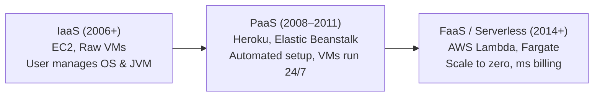

# Cloud Architecture & AWS Services for Java Backends

## 1. Enterprise AWS Architecture for Java Backends

### Core AWS Services & Enterprise Stack Mapping

In an enterprise Java ecosystem transitioning from on-premises/private cloud infrastructure to Amazon Web Services (AWS), core infrastructure components map directly to AWS managed cloud services:

| Architecture Layer | AWS Cloud Managed Service | On-Premises / Private Cloud Equivalent | Technical Responsibility |
| :--- | :--- | :--- | :--- |
| **Networking & Routing** | **AWS Application Load Balancer (ALB)** / **Amazon API Gateway** | Nginx, HAProxy, F5 Big-IP, Kong | Layer 7 request routing, SSL/TLS termination, rate limiting, and path-based dispatching. |
| **Compute Engine** | **Amazon EC2** & **AWS Lambda** | Dedicated Linux VMs (CentOS, AlmaLinux, RHEL) | Host environment executing Spring Boot JVM processes and event-driven functions. |
| **Relational Database** | **Amazon RDS** (PostgreSQL / Aurora) | On-prem PostgreSQL, Oracle Database | ACID transactional storage, automated failover, read replicas, and snapshot backups. |
| **Decoupled Messaging** | **Amazon SQS** (Simple Queue Service) | RabbitMQ, ActiveMQ, IBM MQ | Asynchronous task buffering, distributed queueing, point-to-point worker dispatching. |
| **Event Streaming** | **Amazon Kinesis** / **Amazon MSK** (Managed Streaming for Kafka) | Apache Kafka, Apache Pulsar | Real-time event streaming, event sourcing, high-throughput distributed log ingestion. |
| **Object Storage** | **Amazon S3** (Simple Storage Service) | Ceph, MinIO, SAN/NAS Storage | Unstructured blob storage (PDF exports, logs, user media) with 99.999999999% durability. |
| **Secrets & Encryption** | **AWS KMS** (Key Management Service) / **Secrets Manager** | HashiCorp Vault | Envelope encryption, customer master keys (CMK), automated secret rotation. |
| **Security & Identity** | **AWS IAM** (Identity & Access Management) | Active Directory, LDAP, Keycloak | Infrastructure-level authorization (EC2/Lambda role access) vs application-level JWT authentication. |

---

### Six-Layer AWS Java Backend Architecture

A resilient, scalable enterprise AWS architecture for a Java/Spring Boot backend is organized into six functional layers:

```mermaid
flowchart TD
    Client(["External Clients / Web / Mobile"]) --> Layer1["Layer 1: Entry Point (ALB / API Gateway)"]
    
    subgraph VPC ["AWS Virtual Private Cloud (VPC)"]
        Layer1 -->|HTTP/HTTPS REST| Layer2["Layer 2: Compute (Spring Boot on EC2 / ECS Fargate)"]
        
        Layer2 -->|Asynchronous Task Dispatch| Layer3["Layer 3: Decoupling (Amazon SQS Queue)"]
        Layer3 -->|Event Trigger| Layer4["Layer 4: Background Processing (AWS Lambda / Worker EC2)"]
        
        Layer2 -->|Transactional SQL (HikariCP)| Layer5A["Layer 5A: Persistence (Amazon RDS PostgreSQL)"]
        Layer4 -->|Transactional SQL / Write| Layer5A
        Layer2 -->|Unstructured Uploads / Exports| Layer5B["Layer 5B: Object Storage (Amazon S3)"]
        Layer4 -->|Batch Output Files| Layer5B
        
        Layer6["Layer 6: Security & Identity (AWS IAM Roles & Policies)"] -.->|Instance Profiles / AssumeRole| Layer2
        Layer6 -.->|Execution Roles| Layer4
    end
```

#### Layer-by-Layer Architectural Responsibilities:

1. **Layer 1: Entry Point (Networking/Routing):**
   - External HTTPS traffic from frontend clients hits an **Application Load Balancer (ALB)** or **Amazon API Gateway**.
   - Handles SSL/TLS termination, health check routing, cross-zone load balancing, and forward authentication headers to the backend.

2. **Layer 2: Compute (The Application):**
   - The ALB dispatches HTTP requests across an Auto Scaling Group of **Amazon EC2** instances or ECS Fargate tasks running a Java/Spring Boot application.
   - Operating systems (e.g., hardened AlmaLinux 9) host tuned JVM runtimes (e.g., Eclipse Temurin OpenJDK 21) configured for heap sizes, garbage collection (G1GC/ZGC), and systemd service supervision.

3. **Layer 3: Decoupling (Asynchronous Messaging):**
   - For long-running or computationally heavy business operations (e.g., batch data processing, document generation, billing reconciliations), the Spring Boot application avoids synchronous thread-blocking.
   - It enqueues an event message into an **Amazon SQS** queue and returns a fast `202 Accepted` response to the client with a correlation ID.

4. **Layer 4: Background Processing (Serverless Workers):**
   - An **AWS Lambda** function or a dedicated asynchronous worker process on an EC2 instance polls or is triggered by the SQS queue.
   - It processes messages independently, handling retries via Dead Letter Queues (DLQ) without impacting the throughput of Layer 2 web servers.

5. **Layer 5: Persistence (Data & Storage):**
   - **Relational Data:** Transactional state is persisted to **Amazon RDS (PostgreSQL engine)** deployed in Multi-AZ configuration for automated replication and sub-minute failover.
   - **Unstructured Data:** Large files, binary blobs, invoice PDFs, and exports are stored directly in **Amazon S3** buckets with encrypted server-side storage (SSE-KMS) and lifecycle transition rules.

6. **Layer 6: Security (The Wrapper):**
   - **AWS IAM** provides an infrastructure-wide security perimeter.
   - Applications running on EC2 or Lambda assume **IAM Roles via Instance Profiles** to obtain short-lived, dynamically rotated STS credentials. No static AWS access keys (`AWS_ACCESS_KEY_ID` / `AWS_SECRET_ACCESS_KEY`) are ever hardcoded or stored in environment variables.

---

## 2. Amazon EC2 Compute Architecture

### EC2 Architectural Model & Golden AMI Strategy

**Amazon Elastic Compute Cloud (EC2)** provides scalable virtual computing capacity in the cloud. In enterprise architectures, EC2 instances represent virtual Linux servers running on AWS Nitro System hardware abstractions.

#### The Golden AMI Pattern

Rather than provisioning raw base operating systems and running runtime installation scripts on every boot, production enterprise deployments utilize **Golden AMIs (Amazon Machine Images)**:

- **Concept:** A pre-baked, immutable VM image containing the hardened operating system (e.g., AlmaLinux 9 migrated from CentOS), security agents (CrowdStrike, Qualys), monitoring daemons (CloudWatch Agent, Prometheus node-exporter), system optimizations (kernel sysctl tuning, file descriptor limits), and the target Java Runtime Environment (OpenJDK 21).
- **Automation Pipeline:** Built using HashiCorp Packer or AWS EC2 Image Builder via CI/CD pipelines.
- **Enterprise Benefits:**
  - **Deterministic Launches:** Eliminates external network dependency during instance startup (e.g., `dnf/yum update` or downloading Java packages at boot).
  - **Instant Autoscaling:** Reduces boot-to-service time from 10–15 minutes down to 60–90 seconds.
  - **Security Compliance:** Enforces vulnerability patching and CIS benchmark compliance before any instance enters the production cluster.

---

### EC2 Instance Families & Workload Optimization

AWS categorizes EC2 instances into distinct families optimized for specific resource profiles:

| Instance Family | Representative Types | Resource Characteristics | Recommended Java Backend Workload |
| :--- | :--- | :--- | :--- |
| **General Purpose** | `t3`, `t4g` (Graviton), `m6i` (Intel), `m7g` (Graviton) | Balanced ratio of vCPU, memory (4 GiB per vCPU), and network bandwidth. | Standard Spring Boot REST APIs, microservices, and orchestration gateways with steady, balanced traffic. |
| **Compute Optimized** | `c6i`, `c7g` | High ratio of compute performance relative to memory (2 GiB per vCPU). High turbo clock speeds. | CPU-intensive batch processing, cryptography, financial algorithms, API routing proxies, and compression jobs. |
| **Memory Optimized** | `r6i`, `r7g`, `x2gd` | High memory footprint per vCPU (8 GiB to 16 GiB per vCPU). | Large JVM heaps (>32 GiB), in-memory data grids (Hazelcast, Apache Ignite), high-volume Redis caching, and databases. |
| **Storage Optimized** | `i3en`, `im4gn` | Non-Volatile Memory Express (NVMe) SSD physical storage with ultra-low latency and high IOPS. | High-throughput distributed storage engines, log collectors (Elasticsearch/OpenSearch), and Kafka brokers. |

---

### Security Groups vs Network Access Control Lists (NACLs)

AWS provides defense-in-depth networking security using Security Groups and Network Access Control Lists (NACLs):

| Feature / Dimension | Security Group (SG) | Network Access Control List (NACL) |
| :--- | :--- | :--- |
| **Operating Level** | **Instance Level** (Virtual interface / ENI). | **Subnet Level** (Boundary of the entire subnet). |
| **State Tracking** | **Stateful:** If an inbound request is permitted on a port, the outbound response is **automatically allowed** regardless of outbound rules. | **Stateless:** Return traffic must be **explicitly permitted** in the outbound rules (including ephemeral ports `1024–65535`). |
| **Rule Types** | Supports **Allow rules only**. Denies everything else by default. Cannot create explicit Deny rules. | Supports both **Allow** and **Deny** rules (evaluated numerically in ascending order). |
| **Rule Evaluation** | All rules are evaluated simultaneously before deciding whether to permit traffic. | Rules are processed strictly in sequential numerical order; processing halts on first match. |
| **Primary Use Case** | Fine-grained host firewall (e.g., allow TCP port `8080` only from the ALB's Security Group ID). | Subnet-wide perimeter defense (e.g., blocking malicious IP CIDR blocks or enforcing compliance boundaries). |

---

### High Availability with Auto Scaling Groups (ASG) & Application Load Balancers (ALB)

Production enterprise deployments never run standalone, single EC2 instances. High availability and self-healing are achieved by pairing an **Auto Scaling Group (ASG)** with an **Application Load Balancer (ALB)** across multiple Availability Zones (Multi-AZ):

```
       +-------------------------------------------------------------+
       |               Application Load Balancer (ALB)               |
       +-------------------------------------------------------------+
                   |                                       |
                   v (Health Probe /actuator/health)       v (Health Probe /actuator/health)
      +-------------------------+             +-------------------------+
      |  Availability Zone A    |             |  Availability Zone B    |
      | +---------------------+ |             | +---------------------+ |
      | | EC2 (Spring Boot)   | |             | | EC2 (Spring Boot)   | |
      | | Status: Healthy 200 | |             | | Status: Unhealthy   | |
      | +---------------------+ |             | +---------------------+ |
      +-------------------------+             +-------------------------+
                                                           |
                                               ASG Terminates & Replaces VM
```

#### Self-Healing & Scaling Mechanics:
1. **Health Probes:** The ALB continuously evaluates backend health by querying the Spring Boot Actuator endpoint (`GET /actuator/health`).
2. **Traffic Drain (Deregistration Delay):** When an instance fails health checks or an ASG scale-in event occurs, the ALB stops routing new connections to that instance and allows in-flight requests to complete within a configurable deregistration timeout (e.g., 30–60 seconds).
3. **Automated Replacement:** If the JVM process crashes or returns non-200 responses consistently, the ASG marks the instance unhealthy, terminates the underlying VM, and provisions a fresh EC2 instance from the Golden AMI in the same or alternate Availability Zone.
4. **Dynamic Scaling Policies:** Target tracking scaling policies automatically scale the instance count up or down based on metrics such as ALB Request Count Per Target (`ALBRequestCountPerTarget`) or Average CPU Utilization.

---

### Storage Mechanics: Elastic Block Store (EBS) vs Instance Store

EC2 compute instances interact with two distinct block storage architectures:

| Architectural Property | Amazon Elastic Block Store (EBS) | Amazon EC2 Instance Store |
| :--- | :--- | :--- |
| **Physical Attachment** | **Network-Attached:** Virtual block storage connected over a dedicated storage network (EBS-optimized links). | **Physically Attached:** NVMe or SATA SSD drives physically integrated into the host server chassis. |
| **Data Persistence** | **Persistent:** Data survives instance stop, restart, and termination (if `DeleteOnTermination=false`). Can be snapshotted to S3. | **Ephemeral:** Data is **permanently lost** if the instance is stopped, terminated, or suffers hardware failure. Survives OS reboots only. |
| **Performance Profile** | Predictable IOPS and throughput based on volume type (`gp3`, `io2 Block Express`). Modest network latency overhead. | **Ultra-high IOPS** with microsecond-level latency and massive sequential throughput (direct bus attachment). |
| **Recommended Use Case** | OS root volumes, persistent application data, database storage, and stateful enterprise logs. | Temporary swap space, scratch buffers, high-performance distributed caching, and replicated data nodes. |

---

### Automated Bootstrapping with EC2 User Data

**User Data** is a shell script or cloud-init configuration executed automatically with `root` privileges during the initial launch phase of an EC2 instance:

```bash
#!/bin/bash
set -e

# Log all output to boot log
exec > >(tee /var/log/user-data.log|logger -t user-data -s 2>/dev/console) 2>&1

echo "Starting Application Bootstrapping at $(date)"

# 1. Retrieve the latest production JAR artifact from private S3 using IAM Role credentials
aws s3 cp s3://enterprise-build-artifacts-us-east-1/payment-service/payment-service-release.jar /opt/app/app.jar

# 2. Set ownership and permissions
chown -R springboot:springboot /opt/app
chmod 500 /opt/app/app.jar

# 3. Reload systemd daemon and enable service
systemctl daemon-reload
systemctl enable --now payment-service.service

echo "Application Bootstrapping Complete at $(date)"
```

---

## 3. Serverless Compute with AWS Lambda

### Amazon EC2 vs AWS Lambda Architectural Trade-offs

| Dimension | Amazon EC2 (Elastic Compute Cloud) | AWS Lambda (Serverless Compute) |
| :--- | :--- | :--- |
| **Core Abstraction** | Full virtual machines with dedicated Linux/Windows kernels. | Ephemeral execution environments (micro-VMs) executing isolated functions. |
| **Lifecycle & Execution Limit** | **Continuous (24/7):** Runs indefinitely until stopped or terminated. | **Event-Driven:** Spins up on trigger, executes, and terminates. **Hard 15-minute (900s) timeout**. |
| **OS & Infrastructure Maintenance** | **Developer Managed:** Kernel patching, security hardening, OpenJDK updates, OS upgrades. | **AWS Managed:** AWS maintains the underlying Linux OS, security patches, and language runtime. |
| **Scaling Dynamics** | **Minutes:** Auto Scaling Groups boot new virtual machines and initialize JVMs. | **Sub-second:** Concurrently spawns execution sandboxes up to account limits (default 1,000 concurrent per region). |
| **Billing Model** | Provisioned capacity: Billed per second/hour regardless of whether the server is busy or idle. | True Pay-per-Use: Billed per millisecond of execution duration and invocation count. **$0 cost when idle**. |
| **Primary Java Sweet Spot** | Enterprise Spring Boot microservices, high-traffic monolithic backends, persistent WebSocket servers. | Asynchronous SQS consumer jobs, S3 event triggers, scheduled cron tasks, spiky/unpredictable webhooks. |

---

### Java Cold Starts & AWS Lambda SnapStart

#### The Java Cold Start Problem
When a Lambda function receives an invocation and no idle execution sandbox is available, AWS initiates a **Cold Start**:
1. Spawns an ephemeral Firecracker micro-VM.
2. Initializes the Java Virtual Machine (HotSpot).
3. Loads compiled classes, verifies bytecode, and executes static initialization blocks.
4. Initializes heavy application frameworks (e.g., Spring Boot `ApplicationContext`, dependency injection graph, Hibernate metadata).

For Java applications, this cold start sequence can require **2 to 6+ seconds**, introducing unacceptable latency spikes for synchronous HTTP APIs.

#### Solution 1: AWS Lambda SnapStart (Firecracker Snapshot Restoration)
- **Mechanism:** When a version of a Java Lambda function is published with SnapStart enabled, AWS initializes the function's runtime, executes static initialization blocks, and initializes the framework context ahead-of-time. AWS then takes an encrypted memory and disk snapshot of the Firecracker micro-VM and caches it.
- **Runtime Performance:** Subsequent cold-start invocations restore the pre-initialized execution state directly from the snapshot, reducing cold start latency from ~5 seconds down to **under 200 milliseconds**.
- **Availability:** Supported for Java 11, Java 17, and Java 21+ runtimes at no additional charge.

#### Alternative Cold Start Mitigations:
- **GraalVM Native Image:** Compiles Java applications Ahead-Of-Time (AOT) into native machine binaries, eliminating JVM startup overhead (<50ms startup), but requiring build-time reflection configuration.
- **Provisioned Concurrency:** Pre-warms and maintains a pool of initialized execution environments ready to respond instantly, billed continuously for the pre-warmed capacity.

---

### Lambda Resource Allocation & CPU Proportionality

In AWS Lambda, **vCPU performance cannot be configured independently**. Computing power is scaled strictly as a linear function of allocated **Memory**:

$$	ext{vCPU Allocation} \propto 	ext{Allocated Memory (MB)}$$

- **Configuration Range:** 128 MB to 10,240 MB (in 1 MB increments).
- **vCPU Thresholds:** At **1,769 MB of Memory**, AWS Lambda allocates the exact equivalent of **1 full vCPU** (one full hyperthread on a physical processor). Allocating 3,538 MB provides 2 vCPUs; 10,240 MB provides 6 vCPUs.
- **Enterprise Optimization Nuance:** If a Java Lambda function is CPU-bound (e.g., performing JSON parsing, cryptography, or heavy arithmetic) and running slowly, the direct remediation is to **increase allocated memory**. Increasing memory from 512 MB to 2048 MB grants 4x more CPU cycles, frequently reducing execution time by more than 4x and resulting in lower overall cost despite the higher memory rate.

---

### Execution Context Reuse & Amazon RDS Proxy Connection Management

#### 1. Execution Context Reuse & Cold vs Warm Optimization
AWS Lambda preserves execution environments across consecutive invocations ("warm starts"). Code placed outside the request handler is executed only during cold start initialization:

```java
public class OrderProcessingLambda implements RequestHandler<SQSEvent, Void> {

    // INITIALIZED ONCE DURING COLD START:
    // Static / instance fields persist across warm invocations.
    private static final S3Client s3Client = S3Client.builder()
            .region(Region.US_EAST_1)
            .httpClientBuilder(UrlConnectionHttpClient.builder())
            .build();

    private static final ObjectMapper objectMapper = new ObjectMapper();

    @Override
    public Void handleRequest(SQSEvent event, Context context) {
        // EXECUTED ON EVERY INVOCATION:
        // Must remain strictly stateless; do not store request-specific state in static fields.
        for (SQSEvent.SQSMessage msg : event.getRecords()) {
            processMessage(msg.getBody());
        }
        return null;
    }
}
```

#### 2. The Database Connection Pool Exhaustion Trap & Amazon RDS Proxy
- **The Problem:** Traditional relational databases (PostgreSQL) allocate memory and processes per open client connection (e.g., standard PostgreSQL max connections $pprox 100 - 500$). When a traffic surge triggers 1,000 concurrent Lambda sandboxes, each sandbox opening its own HikariCP connection pool immediately overwhelms and crashes the database.
- **The Solution (Amazon RDS Proxy):** An enterprise database proxy placed between Lambda and Amazon RDS PostgreSQL. RDS Proxy pools, consolidates, and shares thousands of ephemeral Lambda connections down to a small, persistent pool of database connections, preventing connection exhaustion and preserving database CPU/RAM.

```
+------------------+
| Lambda Sandbox 1 | ---+------------------+     \     +--------------------+     +-------------------+
| Lambda Sandbox 2 | ----->--->|  Amazon RDS Proxy  | --->|  Amazon RDS       |
+------------------+     /     | (Connection Pool)  |     |  PostgreSQL DB    |
| Lambda Sandbox N | ---/      +--------------------+     +-------------------+
+------------------+
```

---

### Java FaaS Function Anatomy vs Traditional Spring Boot Controller

#### Traditional Spring Boot Controller (Always-On Server Model):
```java
@RestController
public class UserController {

    private final UserService userService;

    public UserController(UserService userService) {
        this.userService = userService;
    }

    @PostMapping("/users")
    public ResponseEntity<UserResponse> createUser(@RequestBody UserRequest request) {
        // 1. App runs 24/7 on port 8080.
        // 2. Spring routes the incoming HTTP request here.
        return ResponseEntity.ok(userService.save(request));
    }
}
```

#### AWS Lambda FaaS Function (Event-Driven Method Model):
```java
public class CreateUserFunction implements RequestHandler<UserRequest, Response> {

    private static final UserService userService = new UserServiceImpl();

    @Override
    public Response handleRequest(UserRequest request, Context context) {
        // 1. AWS boots this method ONLY when triggered.
        // 2. No Tomcat, no port 8080, no @RestController.
        return userService.save(request);
    }
}
```

---

## 4. Alternative Serverless Runtimes & Container Orchestration

### Serverless Beyond Lambda: AWS Fargate & AWS App Runner

In enterprise cloud architecture, **Serverless** is not limited to Function-as-a-Service (Lambda); it represents any operational model where developers manage zero underlying operating systems or virtual machine hardware, with automatic scaling and pay-for-use billing.

#### AWS Fargate (Serverless Containers / CaaS)
- **Concept:** A serverless compute engine for containers that works with both **Amazon ECS** and **Amazon EKS**.
- **Why Enterprise Spring Boot Developers Prefer Fargate:**
  - **No Cold Start Degradation:** Applications run continuously inside Docker containers without the cold-start latencies of Lambda.
  - **No 15-Minute Timeout:** Long-running web applications, batch jobs, and distributed microservices run without execution duration caps.
  - **Standard Spring Boot Compatibility:** Standard Spring Boot web applications (`spring-boot-starter-web`), HikariCP connection pools, and Actuator endpoints deploy directly without refactoring into function interfaces.
  - **Zero OS Maintenance:** Eliminates Linux OS security patching, kernel upgrades, and Golden AMI management. You specify CPU and RAM requirements (e.g., `2 vCPU, 4 GiB RAM`), and AWS provisions the underlying infrastructure.

#### AWS App Runner
- A fully managed container application service that deploys web applications directly from a source code repository (GitHub) or container image. Automatically manages VPC networking, load balancing, SSL certificates, and autoscaling with zero orchestration configuration.

---

### Evolution of Cloud Compute: PaaS vs Serverless FaaS



#### Historical Context:
- **PaaS Ancestors (2007–2011):** Platforms like Heroku (2007), Google App Engine (2008), and AWS Elastic Beanstalk (2011) automated application deployment from JAR/WAR files.
- **Why PaaS Was Not "True" Serverless:** In Elastic Beanstalk, AWS automatically provisioned real underlying EC2 instances, load balancers, and Tomcat servers. However, those EC2 instances remained running 24/7 in the customer's VPC, billing for idle capacity at 3:00 AM, and autoscaling required minutes to boot fresh virtual machines rather than scaling instantaneously to zero.
- **FaaS Emergence (2014):** AWS Lambda pioneered true Function-as-a-Service with sub-second provisioning, native event triggers, per-millisecond billing, and automatic scaling to zero when idle.

---

### Container Orchestration: Amazon ECS vs Amazon EKS

When deploying containerized Spring Boot microservices, AWS offers two primary orchestrators:

| Architectural Dimension | Amazon ECS (Elastic Container Service) | Amazon EKS (Elastic Kubernetes Service) |
| :--- | :--- | :--- |
| **Underlying Engine** | AWS proprietary container orchestration system. | Certified upstream Kubernetes (CNCF compliant). |
| **Learning Curve** | **Low:** Minimal operational complexity; highly integrated with AWS-native primitives. | **High:** Requires comprehensive knowledge of Kubernetes APIs, controllers, and ecosystem tools. |
| **Control Plane Cost** | **$0 / month:** No charge for the ECS cluster control plane. | **$0.10 / hour (~$73 / month)** control plane fee per cluster. |
| **Portability & Lock-in** | Locked into AWS APIs and Task Definition schemas. | **Fully Portable:** Manifests run across AWS (EKS), Azure (AKS), Google Cloud (GKE), and on-premises clusters. |
| **Ecosystem & Tooling** | AWS native: Amazon CloudWatch, AWS IAM, Application Load Balancers. | Vast open-source ecosystem: Helm, Istio, Prometheus, ArgoCD, Calico, Cert-Manager. |
| **Core Abstractions** | Task Definitions, Tasks, Services, Clusters. | Manifests, Pods, Deployments, Services, Ingress, Namespaces. |

#### Control Plane vs Data Plane in EKS:
- **Control Plane:** AWS manages and scales the Kubernetes master nodes (`kube-apiserver`, `etcd`, `kube-controller-manager`) across multiple Availability Zones, ensuring high availability backed by an SLA.
- **Data Plane (Worker Nodes):** The worker nodes executing Java container pods run on either **AWS Fargate** (serverless) or **EC2 Linux instances**. When running worker nodes on EC2, private cloud Linux skills (systemd, kernel parameters, cgroups, memory limits, and networking) apply directly when diagnosing node pressure or Pod evictions.

---

### Cloud Infrastructure Management: Console, CLI & Infrastructure as Code (IaC)

Enterprise cloud engineering balances three interaction planes:

1. **AWS Management Console (Web UI):**
   - Centralized web portal providing dedicated graphical dashboards for each AWS service.
   - Ideal for exploratory learning, ad-hoc monitoring, visual debugging of CloudWatch metrics, and inspecting resource health.
   - **Anti-pattern in Production:** Creating production resources via manual console clicks ("ClickOps") introduces unversioned configuration drift, human error, and non-reproducible environments.

2. **AWS Command Line Interface (CLI):**
   - Open-source terminal tool enabling direct control of all AWS services via scriptable shell commands (e.g., `aws ec2 describe-instances --filters Name=instance-state-name,Values=running`).
   - Essential for operational troubleshooting, local developer scripting, and ad-hoc query validation.

3. **Infrastructure as Code (IaC - Enterprise Standard):**
   - The mandatory enterprise standard for provisioning and managing infrastructure (e.g., **Terraform**, **AWS CloudFormation**, **AWS CDK**).
   - **Core Tenets:** Infrastructure specifications are defined declaratively in version-controlled code repositories, validated through automated code reviews, deployed via CI/CD pipelines, and rolled back deterministically.

---
