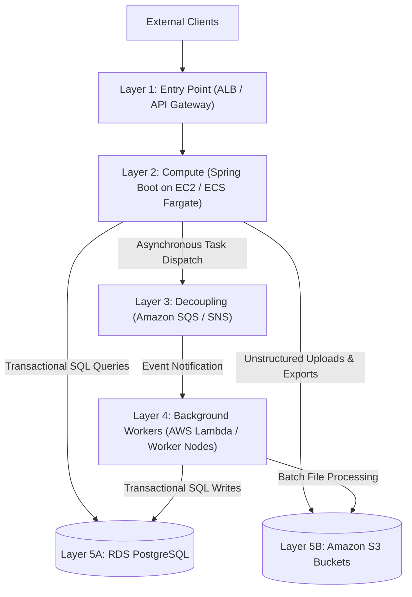

# Notes - Cloud - 1. Foundations & Architecture

## 1. Cloud Provider Strategy & Architectural Foundations

### Cloud Provider Evaluation & AWS Platform Selection

When evaluating cloud infrastructure for modern enterprise Java and Spring Boot backend engineering, the primary hyper-scale providers—Amazon Web Services (AWS), Microsoft Azure, and Google Cloud Platform (GCP)—offer comparable core infrastructure primitives (virtual machines, managed relational databases, message queues, object storage, and serverless runtimes). However, platform selection in enterprise environments is driven by strategic ecosystem alignment, operational maturity, and architectural control:

| Cloud Platform | Primary Enterprise Strengths | Common Architectural Fit | Java Ecosystem Integration |
| :--- | :--- | :--- | :--- |
| **Amazon Web Services (AWS)** | Deepest operational maturity, broadest managed service catalog, fine-grained networking/IAM security controls, and market-leading market share. | Custom Java/Spring Boot microservices, high-throughput distributed systems, event-driven architectures. | Premier support via **AWS SDK for Java v2**, **Spring Cloud AWS**, AWS Lambda SnapStart, and Corretto OpenJDK. |
| **Microsoft Azure** | Seamless enterprise integration with Microsoft identity systems, Active Directory / Microsoft Entra ID, Microsoft 365, and enterprise Windows workloads. | Organizations heavily committed to .NET, Microsoft enterprise software agreements, and hybrid Active Directory infrastructure. | Strong Azure Spring Apps (fully managed Spring runtime co-developed with VMware/Broadcom), Azure Functions. |
| **Google Cloud Platform (GCP)** | Industry-leading big data analytics (BigQuery), machine learning/AI infrastructure (Vertex AI), and native Kubernetes engineering. | Data-intensive workloads, real-time analytics pipelines, and pure open-source container workflows on Google Kubernetes Engine (GKE). | Native container support (Google Cloud Run), Spring Cloud GCP. |

#### Architectural Trade-offs & Evaluation Criteria:
- **Avoid Universal Absolutes:** In technical evaluations and interviews, avoid claiming AWS is objectively superior across all dimensions. Frame choices around ecosystem alignment, team expertise, existing enterprise licensing agreements, and compliance requirements.
- **Operational Complexity:** AWS offers the most granular control over VPC networking, security groups, route tables, and IAM policies. This granularity provides maximum operational security and performance tuning capability, but introduces a steeper initial learning curve compared to more opinionated PaaS environments.

---

### Core AWS Service Pillars & On-Premises Mapping

To transition effectively from on-premises datacenters or private cloud environments (e.g., VMware, OpenStack, CentOS/AlmaLinux bare-metal/VM clusters) to AWS, enterprise Java developers must map core infrastructure components accurately without conflating architectural layers:

| AWS Service Pillar | Primary AWS Managed Services | Accurate On-Premises / Private Cloud Equivalent | Common Misconceptions & Pitfalls to Avoid |
| :--- | :--- | :--- | :--- |
| **Compute Engine** | **Amazon EC2**, **AWS Lambda**, **Amazon ECS / EKS (AWS Fargate)** | Private cloud Linux VMs (CentOS, AlmaLinux, RHEL) or bare-metal hypervisors. | **Pitfall:** Treating AWS Lambda as a direct drop-in replacement for 24/7 web servers. Lambda is ephemeral, event-driven FaaS with a 15-minute timeout. |
| **Relational Database** | **Amazon RDS** (PostgreSQL, Aurora, MySQL) | Self-managed PostgreSQL / Oracle database clusters. | **Pitfall:** Assuming RDS manages application connection pooling. RDS automates OS patching, backups, and Multi-AZ replication; application connection pooling must still be managed via HikariCP or RDS Proxy. |
| **Asynchronous Messaging** | **Amazon SQS** (Point-to-Point Queue), **Amazon SNS** (Pub/Sub Fanout) | RabbitMQ, ActiveMQ, IBM MQ. | **Pitfall:** Mapping SQS to Apache Kafka or GraphQL. Kafka is high-throughput distributed streaming (maps to **Amazon MSK** or **Kinesis**). GraphQL is an application API query language, not an asynchronous broker. |
| **Object Storage** | **Amazon S3** (Simple Storage Service) | Object/blob storage (Ceph, MinIO) or network shares (NAS/SAN). | **Pitfall:** Treating S3 as a POSIX filesystem. S3 is an HTTP REST-based object store, not a block device (that is **Amazon EBS**) or shared NFS mount (that is **Amazon EFS**). |
| **Security & Secrets** | **AWS IAM**, **AWS Secrets Manager**, **AWS KMS** | HashiCorp Vault, Active Directory, CyberArk. | **Pitfall:** Equating AWS IAM with JWT tokens. JWT handles application-level user authentication; IAM governs infrastructure-level cloud authorization (e.g., allowing an EC2 instance to query an S3 bucket). |

---

### Six-Layer Hierarchical AWS Java Backend Architecture

A production-grade, highly available enterprise AWS architecture for Java/Spring Boot applications is structured as an $n$-tier hierarchical request pipeline:

```
+---------------------------------------------------------------------------------------+
|                         LAYER 6: SECURITY & OBSERVABILITY                             |
|       AWS IAM (Roles & Instance Profiles) | AWS Secrets Manager | CloudWatch          |
+---------------------------------------------------------------------------------------+
|  LAYER 1: ENTRY POINT (Networking & Routing)                                          |
|    External Client Traffic ---> Application Load Balancer (ALB) / API Gateway         |
+-------------------------------------------+-------------------------------------------+
                                            |
                                            v (HTTP / HTTPS REST)
+---------------------------------------------------------------------------------------+
|  LAYER 2: COMPUTE (Synchronous Application Tier)                                      |
|    Spring Boot 3 / Java 21 on Amazon EC2 (Auto Scaling Group) or ECS/EKS (Fargate)    |
+---------------------+-------------------------------------+---------------------------+
                      |                                     |
    (Heavy / Async    |                                     | (Synchronous Data /
     Task Dispatch)   v                                     |  Document Retrieval)
+---------------------------------------+                   |
|  LAYER 3: DECOUPLING (Messaging)      |                   |
|    Amazon SQS (Queues) / SNS (Fanout) |                   |
+---------------------+-----------------+                   |
                      |                                     |
                      v (Event Trigger)                     |
+---------------------------------------+                   |
|  LAYER 4: BACKGROUND WORKERS          |                   |
|    AWS Lambda / Worker EC2 Containers |                   |
+---------------------+-----------------+                   |
                      |                                     |
                      +------------------+------------------+
                                         |
                                         v
+---------------------------------------------------------------------------------------+
|  LAYER 5: PERSISTENCE (Data & Storage)                                                |
|    Amazon RDS (PostgreSQL Engine)     |     Amazon S3 (Unstructured Object Store)     |
+---------------------------------------------------------------------------------------+
```



#### Detailed Layer Responsibilities:

1. **Layer 1: Entry Point (Networking/Routing):**
   - External HTTPS requests terminate at an **Application Load Balancer (ALB)** or **Amazon API Gateway**.
   - Handles TLS/SSL termination, web application firewall inspection (AWS WAF), CORS headers, health checks, and path-based routing to backend target groups across multiple Availability Zones.

2. **Layer 2: Compute (Synchronous Application Tier):**
   - The ALB forwards HTTP requests to a cluster of **Spring Boot 3 / Java 21** microservices running on **Amazon EC2** instances managed by an Auto Scaling Group (ASG) or containerized on **Amazon ECS/EKS with AWS Fargate**.
   - Handles low-latency synchronous REST requests, domain validations, and business logic execution.

3. **Layer 3: Decoupling (Asynchronous Messaging):**
   - For long-running or resource-intensive tasks (e.g., generating consolidated financial statements, bulk PDF rendering, sending batch emails), Layer 2 pushes a message payload to an **Amazon SQS** queue.
   - Enables Layer 2 to return an immediate HTTP `202 Accepted` response with a correlation tracking ID, preventing thread starvation and connection timeouts.

4. **Layer 4: Background Workers (Serverless Processing):**
   - Dedicated **AWS Lambda** functions or asynchronous worker processes consume messages from the SQS queue.
   - Processes tasks asynchronously with built-in retries and Dead Letter Queue (DLQ) error isolation.

5. **Layer 5: Persistence (Data & Storage):**
   - **Structured Relational Data:** Stored in **Amazon RDS (PostgreSQL)** configured with Multi-AZ synchronous replication and read replicas for read-intensive query offloading.
   - **Unstructured Objects:** File uploads, user media, invoice PDFs, and audit logs are stored in **Amazon S3** buckets with server-side encryption (SSE-KMS).

6. **Layer 6: Security & Observability (The Infrastructure Wrapper):**
   - **AWS IAM:** Enforces least-privilege access using IAM Roles attached to EC2 instance profiles and ECS task execution roles. No long-lived AWS access keys are ever stored in code or configuration files.
   - **AWS Secrets Manager:** Securely stores and dynamically rotates database credentials and third-party API keys, injecting them into Spring Boot at startup.
   - **Amazon CloudWatch:** Collects system metrics (CPU, RAM, disk I/O) and centralizes distributed Spring Boot logs for real-time alerting and troubleshooting.

---
