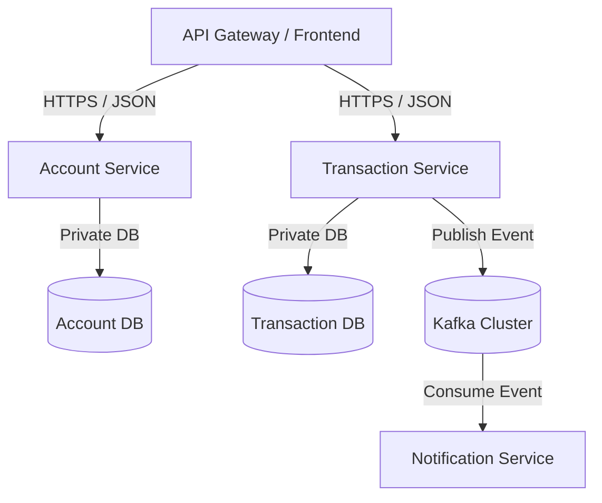
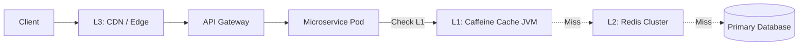
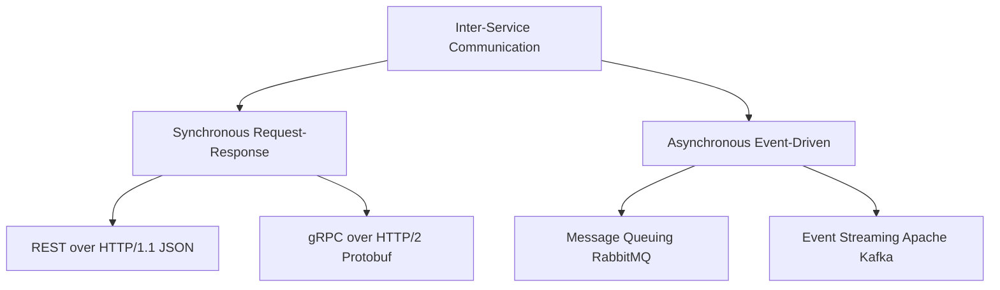
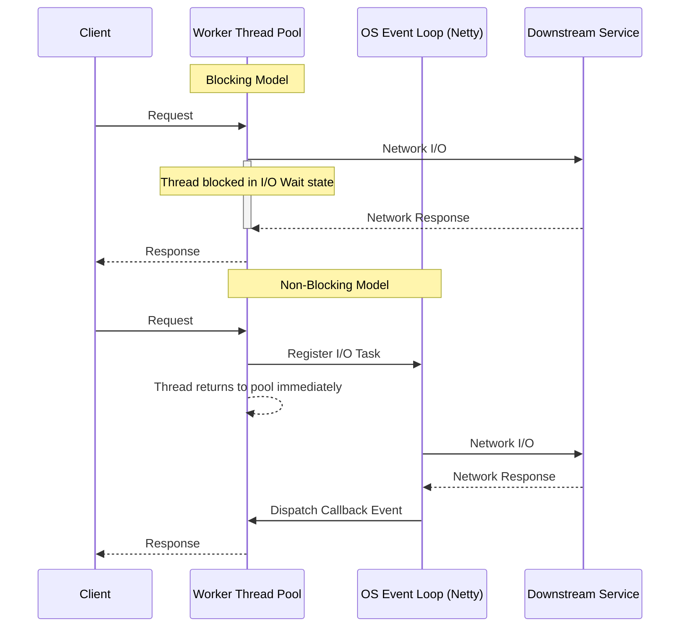
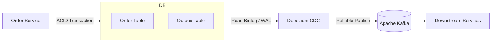
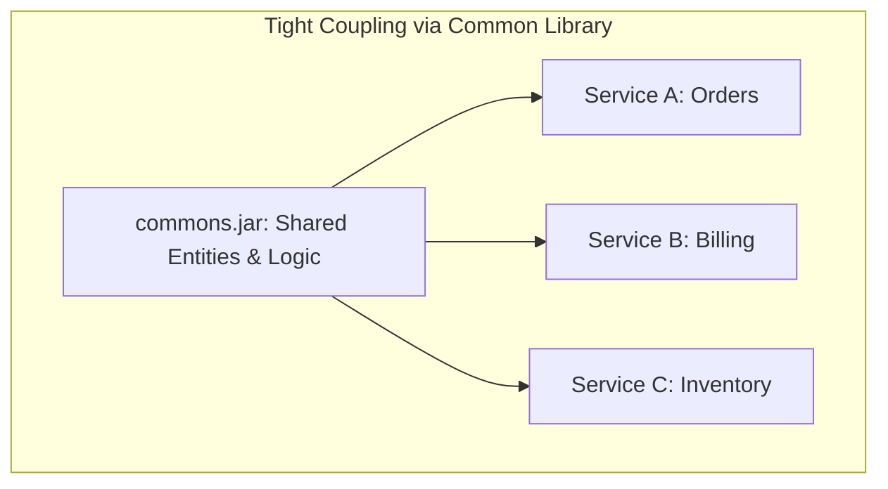

# Chapter 1: Microservices Fundamentals & Inter-Service Communication

## Microservices Architecture Fundamentals

### Core Architecture and Spring Boot Support

#### Definition
Microservices architecture is an architectural style that structures an application as a collection of small, autonomous, loosely coupled services modeled around distinct business capabilities (Bounded Contexts in Domain-Driven Design). Each microservice owns its business domain, exposes well-defined APIs, manages its own private database (Database-per-Service pattern), and can be deployed, scaled, and upgraded independently.

#### Why It Exists
Monolithic applications suffer from coupling bottlenecks as organizations scale:
- **Deployment Monopolies:** A one-line bug fix in a non-critical module requires recompiling and deploying the entire multi-gigabyte monolith, risking system-wide regressions.
- **Scaling Inefficiencies:** Scaling a high-traffic subsystem (e.g., payment processing) requires scaling the entire monolith, wasting compute resources on idle components.
- **Team Coordination Drag (Conway's Law):** Dozens of engineering teams committing to a single repository create severe merge conflicts, coordination overhead, and slow release cycles.

#### How It Works: The Banking System Example
In an enterprise core banking architecture, business capabilities are partitioned into isolated services:
- **Account Service:** Manages customer account lifecycles, KYC states, and balances with its own transactional database.
- **Transaction Service:** Executes fund transfers, inter-bank payments, and ledger posting with dedicated high-throughput storage.
- **Notification Service:** Dispatches transactional SMS, email notifications, and push alerts by consuming downstream events without direct coupling to account operations.



#### How Spring Boot Enables Microservices
Spring Boot serves as the de facto Java enterprise framework for microservices by eliminating infrastructure friction:
1. **Embedded Servlet Containers:** Packages Tomcat, Jetty, or Undertow directly inside the executable JAR, eliminating external application server (WebLogic, WebSphere, standalone Tomcat) deployments.
2. **Opinionated Auto-Configuration:** Automatically configures data sources, transaction managers, message listeners, and security filters based on classpath dependencies using conditional annotations (`@ConditionalOnClass`, `@ConditionalOnMissingBean`).
3. **Spring Boot Actuator:** Exposes production-grade operational endpoints out of the box (`/actuator/health`, `/actuator/metrics`, `/actuator/info`, `/actuator/prometheus`) for Kubernetes liveness and readiness probes.
4. **Spring Cloud Integration:** Provides first-class integration with distributed system primitives:
   - Service Discovery: Netflix Eureka / HashiCorp Consul.
   - Dynamic Configuration: Spring Cloud Config Server / Vault.
   - API Routing: Spring Cloud Gateway.
   - Resiliency: Resilience4j circuit breakers and rate limiters.

#### Monolithic to Microservices Transformation (Strangler Fig Pattern)
Migrating a legacy monolith is executed incrementally rather than through a high-risk "big bang" rewrite:
1. **Identify the Seam:** Select a bounded context that is loosely coupled but delivers clear business value (e.g., Notification or Review module).
2. **Deploy the Interceptor:** Position an API Gateway (or reverse proxy) in front of the legacy monolith.
3. **Build the Microservice:** Develop the new service with its own isolated database.
4. **Dual Writes / Event Sourcing:** Capture state changes from the monolith via Change Data Capture (CDC via Debezium) or application-level events to keep data synchronized.
5. **Route Traffic:** Gradually route traffic from the monolith to the new microservice via gateway routing rules.
6. **Decommission Monolith Component:** Once the new service proves stable under production load, remove the legacy module from the monolith.

---

### System Scalability and State Management

#### Scaling Dimensions in Microservices
Microservices scale along three distinct dimensions (The Scale Cube):
- **X-Axis (Horizontal Duplication):** Running identical instances behind a load balancer. Kubernetes Deployments scale stateless pod replicas via Horizontal Pod Autoscaler (HPA) based on CPU/memory utilization or custom Prometheus metrics.
- **Y-Axis (Functional Decomposition):** Splitting different functions into independent microservices so that resource-intensive services (e.g., PDF generation or image rendering) scale independently from lightweight I/O services.
- **Z-Axis (Data Partitioning / Sharding):** Routing requests based on customer geographic region, tenant ID, or user hash (e.g., sharding databases and service partitions for multi-tenant SaaS).

#### Stateless vs. Stateful Services
Understanding the architectural boundary between stateless and stateful services is fundamental for cloud-native reliability.

| Architectural Dimension | Stateless Services | Stateful Services |
| :--- | :--- | :--- |
| **State Location** | No persistent client data held in local RAM/disk between requests. | Local memory or disk retains state across multiple sequential interactions. |
| **Request Routing** | Any replica can serve any request interchangeably. | Requests must route to specific nodes (sticky sessions / session affinity). |
| **Resilience & Failover** | Instantaneous. If an instance crashes, traffic immediately shifts to healthy replicas. | Complex. Requires state replication, leader election, and disk re-attachment. |
| **Scalability** | Trivial auto-scaling (add/remove pods in seconds via HPA). | Difficult. Re-sharding data and rebalancing partitions introduces downtime risks. |
| **Primary Examples** | REST API Gateways, Business Calculation Services, Auth Token Verifiers. | Apache Kafka brokers, Redis clusters, Relational/NoSQL databases, WebSocket servers. |

#### Implementation Mechanics: Transitioning to Stateless Architecture
- **Authentication:** Replace server-side HTTP sessions (`HttpSession` stored in Tomcat memory) with self-contained cryptographic tokens (JSON Web Tokens - JWT) or external session caches (Spring Session backed by Redis).
- **Persistent State Offloading:** All mutating state is immediately flushed to external distributed data stores (PostgreSQL, MongoDB, Redis) before returning the HTTP response.

---

### Caching Strategies in High-Traffic Systems

#### Multi-Tier Caching Architecture
High-throughput microservices deploy a tiered defense-in-depth caching model to protect core transactional databases:
1. **L1: In-Process Cache (Local JVM):** Extremely low latency (< 1 microsecond). Implemented via Caffeine or Guava Cache. Ideal for immutable or rarely changing configuration data.
2. **L2: Distributed Cache (Shared Cluster):** Low latency (1–5 ms). Implemented via Redis Cluster or Memcached. Accessible by all stateless microservice instances, ensuring cache consistency across the fleet.
3. **L3: Edge Caching (CDN):** Deployed at point-of-presence (PoP) locations (Cloudflare, AWS CloudFront) for static assets and cacheable GET API payloads using standard `Cache-Control` headers.



#### Cache Read/Write Patterns
- **Cache-Aside (Lazy Loading):** The application first queries the cache. If a cache miss occurs, the application reads from the database, writes the record into the cache with a defined TTL, and returns the result.
- **Write-Through:** The application writes data to the cache, and the cache synchronously writes to the underlying database before acknowledging success.
- **Write-Behind (Write-Back):** The application writes data to the cache immediately; the cache asynchronously writes the changes to the database in batch intervals. Provides ultra-high write performance but introduces data loss risk if the cache fails before flush.
- **Refresh-Ahead:** The cache automatically reloads frequently accessed keys before their TTL expires based on access pattern predictions.

#### Cache Failure Modes and Mitigation Strategies
- **Cache Penetration:** Malicious or malformed requests query non-existent keys, bypassing the cache entirely and overwhelming the database.
  - *Mitigation:* Bloom Filters deployed in front of the cache to quickly reject non-existent keys; caching null values with short TTLs (e.g., 30 seconds).
- **Cache Breakdown (Stampede):** A single hot key expires, and thousands of concurrent requests simultaneously hit the database to recompute it.
  - *Mitigation:* Distributed Mutex locks (e.g., Redis `SETNX` or Redlock) allowing only one thread to rebuild the cache while others wait or return stale data; Probabilistic early expiration (XFetch algorithm).
- **Cache Avalanche:** A large percentage of cached keys expire at the exact same second, dumping all read traffic onto the database.
  - *Mitigation:* Inject random jitter into key TTLs (e.g., `TTL = baseTTL + randomJitter(0, 300)` seconds); deploy Redis in High Availability (HA) cluster mode with Sentinel/clustering.

---

### Advantages, Disadvantages and Trade-offs

#### Advantages of Microservices
1. **Independent Deployability:** Engineering teams deploy microservices on isolated release cadences without synchronizing release trains or waiting for monolithic deployments.
2. **Targeted Fault Isolation:** A memory leak or runaway query in the Recommendation Service does not bring down the Checkout Service.
3. **Technological Flexibility:** Individual services can choose optimal runtimes and databases suited to their domain (e.g., Java/Spring for transactional ledgers, Python/FastAPI for machine learning pipelines, Neo4j for social graphs).
4. **Fine-Grained Elasticity:** Resources are scaled exclusively on services experiencing demand spikes, optimizing infrastructure costs.

#### Disadvantages and Systemic Complexities
1. **Distributed System Latency:** Replaying single in-memory function calls into multiple network hops over HTTP/TCP introduces substantial serialization, serialization, and network round-trip overhead.
2. **Dual-Write and Consistency Hazards:** The absence of distributed transactions (two-phase commit is widely considered an anti-pattern in cloud architectures) mandates eventual consistency and compensating logic (Sagas).
3. **Observability Overhead:** Root cause analysis requires distributed tracing (Correlation IDs, OpenTelemetry), structured centralized logging (Elasticsearch, Loki), and distributed metrics pipelines.
4. **Operational and Infrastructure Tax:** Requires mature automated CI/CD pipelines, container orchestration (Kubernetes), service meshes (Istio, Linkerd), and robust configuration management.

---

## Inter-Service Communication and Messaging

### Communication Protocols and Paradigms

Inter-service communication is the lifeblood of distributed systems. It splits into two core paradigms:



#### Synchronous Communication (Blocking Request-Response)
The calling service sends an HTTP/gRPC request over the network and suspends thread execution until a response is received.
1. **REST over HTTP/1.1 (JSON):**
   - *Strengths:* Human-readable payloads, universal firewall and browser compatibility, mature tooling, self-describing RESTful verbs.
   - *Weaknesses:* High serialization overhead, verbose text representation, head-of-line blocking at the HTTP/1.1 connection level.
   - *Implementation:* Declarative HTTP clients via Spring Cloud OpenFeign or reactive non-blocking clients via Spring WebClient.
2. **gRPC over HTTP/2 (Protocol Buffers):**
   - *Strengths:* Binary serialization (Protobuf) produces dramatically smaller network payloads; HTTP/2 connection multiplexing allows multiple concurrent requests over a single TCP connection; strictly typed `.proto` contracts generate client/server stubs automatically.
   - *Weaknesses:* Binary payloads require tooling (e.g., `grpcurl`) to inspect and debug; browser support requires gRPC-Web proxying.
   - *Architectural Sweet Spot:* High-throughput internal East-West communication between backend microservices.

#### Asynchronous Communication (Non-Blocking Event-Driven)
The caller publishes a message or event to a broker and immediately resumes local execution without awaiting downstream processing.
1. **Message Brokers (e.g., RabbitMQ):**
   - *Design Paradigm:* Smart broker, dumb consumer. Focuses on command execution, task delegation, and work queues.
   - *Mechanics:* Exchanges route messages to queues using routing keys. Once a consumer processes and acknowledges (`ACK`) a message, the broker removes it from the queue.
2. **Event Streaming Platforms (e.g., Apache Kafka):**
   - *Design Paradigm:* Dumb broker, smart consumer. Focuses on state change propagation and continuous event logs.
   - *Mechanics:* Kafka treats events as an append-only, distributed, immutable commit log partitioned across broker nodes. Consumers track their own read progress via commit offsets. Events remain persisted for a configured retention period, enabling event replay, backpressure buffering, and multiple decoupled consumer groups.

---

### Thread Utilization and Modern Concurrency

#### The Mechanics of Blocking I/O vs. Non-Blocking I/O
The foundational difference between synchronous and asynchronous paradigms lies in OS thread utilization during network operations:

- **Synchronous (Blocking I/O):**
  In traditional servlet architectures (Spring MVC backed by Tomcat), each incoming HTTP request is assigned a dedicated OS platform thread from a finite pool (default: 200 threads). When Thread A invokes a downstream microservice over HTTP, the OS transitions Thread A into an `I/O Wait` state. Thread A consumes ~1 MB of stack memory while doing zero CPU work, blocked until network packets return.
- **Asynchronous (Non-Blocking I/O):**
  Built on event-driven runtimes (Netty, Spring WebFlux). A small pool of worker threads (typically matching CPU core count) dispatches requests to the OS network layer (epoll/kqueue) and immediately registers callbacks. The thread returns to the pool to process other incoming traffic. When network bytes arrive, an event loop thread executes the callback.



#### Thread Pool Exhaustion: The Silent Killer
If downstream Service B experiences latency degradation (e.g., responding in 5 seconds instead of 50 ms), upstream Service A's Tomcat threads stay occupied waiting for responses. Under moderate load (e.g., 50 requests/sec), Service A exhausts all 200 threads in 4 seconds. Consequently, Service A rejects all subsequent incoming requests with `504 Gateway Timeout` or drops connections entirely, despite CPU and RAM utilization remaining near 5%.

#### Distributed Tracing: Solving the Observability Nightmare
While asynchronous messaging decouples services, it breaks standard synchronous thread-local logging (MDC). If a failure occurs in an asynchronous worker, the stack trace terminates at the thread boundary.
- **Modern Solution:** Distributed Tracing via OpenTelemetry and W3C Trace Context.
  - **Trace ID:** A globally unique identifier generated at the entry gateway and propagated across every HTTP header (`traceparent`) and Kafka message header.
  - **Span ID:** Identifies individual segments of work within each microservice boundary.
  - Centralized tracing tools (Zipkin, Jaeger) ingest span data, allowing engineers to reconstruct the complete end-to-end request lifecycle across distributed hops.

#### Java 21+ Virtual Threads (Project Loom)
Historically, non-blocking asynchronous programming forced developers into complex reactive programming paradigms (Reactor, RxJava) characterized by callback chains and steep learning curves.
- **Project Loom Paradigm Shift:** Virtual Threads are ultra-lightweight JVM-managed user-mode threads. Millions of virtual threads can run concurrently on top of a small pool of OS carrier threads.
- **How It Works:** When code running on a virtual thread executes a blocking operation (e.g., JDBC call, `RestTemplate` network request), the JVM automatically unmounts the virtual thread from its carrier thread and parks it. The carrier thread immediately executes other virtual threads. Once I/O completes, the JVM remounts the virtual thread on an available carrier thread.
- **Architectural Value:** Developers write straightforward, readable, imperative, blocking-style code while gaining the elastic throughput of non-blocking reactive engines.

---

### Resiliency and Distributed Data Patterns

#### The Temporal Coupling Trap
Chaining synchronous calls across multiple microservices ($A \rightarrow B \rightarrow C \rightarrow D$) introduces severe temporal coupling:
$$\text{Availability}_{\text{System}} = \text{Availability}_A \times \text{Availability}_B \times \text{Availability}_C \times \text{Availability}_D$$
If each service boasts 99.5% availability, the 4-hop chain drops to $99.5\%^4 \approx 98.02\%$ availability (~7.2 hours of downtime per year). Furthermore, total latency is cumulative. Chained synchronous architecture is an anti-pattern termed a **Distributed Monolith**.
- **Rule of Thumb:** Restrict synchronous communication to read queries or edge-to-service ingress. Use asynchronous messaging for all state mutations.

#### Mandatory Resiliency: Circuit Breakers
Any synchronous HTTP/gRPC invocation must be guarded by a circuit breaker (e.g., Resilience4j). If a downstream dependency fails or exceeds latency thresholds, the breaker transitions to `OPEN`, immediately returning a fallback response or cached default without consuming local thread resources.

#### Dual Writes and the Transactional Outbox Pattern
A classic distributed systems hazard occurs when an application updates its local database and publishes a message to a message broker within the same business operation:

```java
// Anti-Pattern: Dual-Write Hazard
@Transactional
public void createOrder(Order order) {
    orderRepository.save(order);       // Step 1: Database Commit
    kafkaTemplate.send("orders", order); // Step 2: Network Call (May fail!)
}
```
If the database commit succeeds but the network call to Kafka times out or the broker crashes, the system enters an inconsistent state: the order exists in the database, but downstream billing and shipping services are never notified. Conversely, publishing to Kafka first risks notifying consumers of an order whose local database transaction ultimately rolls back.

#### The Transactional Outbox Solution
1. **Atomic Local Transaction:** Store the business entity and an outbox record inside the same local relational database transaction within an ACID boundary.
2. **Asynchronous Log Tailing:** A dedicated log-based CDC agent (e.g., Debezium) monitors the database transaction log (PostgreSQL WAL, MySQL binlog) and reliably streams outbox events to Kafka with at-least-once delivery guarantees.



#### Workflow Coordination: Choreography vs. Orchestration
When coordinating business processes that span multiple microservices (e.g., Order Placement $\rightarrow$ Payment $\rightarrow$ Inventory $\rightarrow$ Shipping):

- **Choreography (Event-Driven):**
  - Services publish events and independently listen to events published by other services.
  - *Pros:* Loose coupling, no central bottleneck, simple to set up for 2–3 step workflows.
  - *Cons:* Difficult to visualize end-to-end flow; tracing state across dozens of services can create an "Event Mirage" (spaghetti event architecture).
- **Orchestration (Coordinator-Driven):**
  - A centralized orchestrator (e.g., Temporal, Camunda, or a dedicated Saga coordinator) explicitly invokes participant services via commands and handles rollbacks if any step fails.
  - *Pros:* Clear visibility of workflow state, explicit timeout handling, straightforward rollback logic.
  - *Cons:* Single point of coordination; risk of the orchestrator becoming a bloated "God Service" containing excessive domain logic.

---

## Service Evolution and Contract Management

### Backward Compatibility and API Versioning

#### Core Principles
Backward compatibility guarantees that deploying an updated version of a provider microservice will not break existing consumers (web frontends, mobile apps, or partner microservices). In true microservice architectures, consumer and provider teams maintain independent release cycles without coordinated deployments.

#### API Versioning Strategies
When non-breaking additive modifications cannot fulfill requirements, explicit versioning is mandatory:

1. **URI Path Versioning (Recommended):**
   - Syntax: `/api/v1/orders` vs. `/api/v2/orders`.
   - *Pros:* Explicit, intuitive, easily routed at API Gateways (Spring Cloud Gateway, Kong, NGINX).
   - *Cons:* URI namespace clutter.
2. **Header Versioning:**
   - Syntax: `X-API-Version: 2`.
   - *Pros:* Preserves pristine URI paths.
   - *Cons:* Requires custom routing rules and header inspection at gateway proxies.
3. **Content Negotiation (Accept Header):**
   - Syntax: `Accept: application/vnd.company.v2+json`.
   - *Pros:* Adheres strictly to REST hypermedia principles.
   - *Cons:* Difficult to test manually via browsers; complex caching configurations on CDNs.

#### Postel's Law and the Tolerant Reader Pattern
Postel's Law (The Robustness Principle): *"Be conservative in what you do, be liberal in what you accept from others."*
- **Provider Rules (Additive Changes):**
  - **Permissible (Non-Breaking):** Adding new optional fields to responses; adding new optional request parameters with sensible defaults.
  - **Forbidden (Breaking):** Renaming existing fields; deleting existing fields; changing data types (e.g., Integer to String); adding mandatory request parameters.
- **Consumer Rules (Tolerant Reader):**
  - Configure JSON parsers (e.g., Jackson `DeserializationFeature.FAIL_ON_UNKNOWN_PROPERTIES = false`) to ignore unrecognized fields rather than throwing runtime exceptions when providers add new properties.

#### Event Schema Compatibility with Schema Registry
For asynchronous event streaming (Kafka), text-based JSON schemas lack runtime enforcement. Modern architectures use binary serialization formats (Apache Avro, Protocol Buffers) backed by a central **Schema Registry** (e.g., Confluent Schema Registry).
- The Schema Registry enforces compatibility modes:
  - **BACKWARD:** Consumers using schema $N$ can read data produced by schema $N-1$.
  - **FORWARD:** Consumers using schema $N-1$ can read data produced by schema $N$.
  - **FULL:** Backward and forward compatible. Ensures consumers and producers can be deployed in any arbitrary order.
- If a developer commits a schema that violates compatibility rules, the Schema Registry rejects the schema registration, immediately breaking the CI/CD build.

#### The Expand-Contract Pattern (Parallel Change)
To modify an existing schema or database structure without system downtime, execute the three-phase **Expand-Contract Pattern**:

```mermaid
flowchart TD
    subgraph Phase 1: Expand
        E1["Deploy Provider: Support both old name & new firstName/lastName"]
        E2[DB: Add new columns alongside old column]
        E3[Write to both; Read from old]
    end
    subgraph Phase 2: Migrate
        M1[Consumers update incrementally to read/write 'firstName/lastName']
        M2[Background batch migrates historic database records]
    end
    subgraph Phase 3: Contract
        C1[Gateway metrics confirm 0% traffic on old 'name' field]
        C2[Deploy Provider: Remove old 'name' field]
        C3[DB: Drop old column safely]
    end
    Phase 1 --> Phase 2 --> Phase 3
```

#### Consumer-Driven Contract (CDC) Testing with Pact
Relying solely on end-to-end integration environments (e.g., shared staging environments) is brittle, slow, and expensive. Senior engineering teams employ Consumer-Driven Contract testing via tools like **Pact**:
1. **Contract Definition:** The consumer writes unit-level mock tests specifying the exact request payload and expected JSON response shape it requires from the provider.
2. **Pact File Publication:** The test generates a JSON contract file (Pact) that is published to a central Pact Broker.
3. **Provider Verification in CI/CD:** During the provider's build pipeline, Pact automatically replays the consumer's contract against the provider's API. If the provider renamed a required field, the provider's build fails immediately before deployment to production.

---

### Shared Libraries and the Share Nothing Principle

#### The Common Library Anti-Pattern
A frequent mistake made by teams transitioning from monoliths to microservices is extracting shared code into a common library (e.g., `commons.jar`, `shared-domain.npm`) to satisfy the DRY (Don't Repeat Yourself) principle.



#### Architectural Hazards of Shared Domain Libraries
1. **Misapplication of DRY:** DRY is intended for single-system boundaries. Applying DRY across independent distributed systems introduces tight compile-time and deployment-time coupling.
2. **Version Pinning and Release Hell:** If Service A requires an updated validation rule in `commons.jar`, the library is updated. However, deploying the new library version risks breaking Service B or C. Teams are forced to coordinate cross-service testing, build cycles, and simultaneous deployments, resurrecting the **Distributed Monolith**.
3. **Loss of Independent Deployability:** The primary architectural benefit of microservices is forfeited.

#### The "Share Nothing" Principle
Microservices must remain completely autonomous. They do not share databases, and they do not share domain business logic.
- **Architectural Maxim:** *"Duplication is far cheaper than the wrong abstraction."*
- Copying 50 lines of DTO or validation code between two services is vastly superior to binding them to a shared library dependency. If Service A's business requirements diverge next week, Service A can modify its internal code without impacting Service B.

#### Permissible vs. Forbidden Shared Code

```
┌────────────────────────────────────────────────────────┐
│              PERMISSIBLE (Technical Code)              │
│  - Custom Logging Formatters & Trace Interceptors      │
│  - Standardized RFC 7807 Error Response Envelopes      │
│  - JWT Verification & Security Filter Utilities        │
│  - Metric Collector Configurations                     │
└────────────────────────────────────────────────────────┘
                           ▲
                           │ STRICT ARCHITECTURAL BOUNDARY
                           ▼
┌────────────────────────────────────────────────────────┐
│             FORBIDDEN (Domain / Business)              │
│  - Domain Entities & Database Mappings                 │
│  - Business Validation Rules & Discount Calculations   │
│  - Core Service Interfaces                             │
│  - Inter-Service DTO Payloads                          │
└────────────────────────────────────────────────────────┘
```

#### The Architect's Alternative: Standalone Microservices
If shared business logic is so complex that duplicating it violates maintainability (e.g., complex tax calculation or unified pricing engine), the solution is **not** a shared library. The logic must be elevated into its own dedicated **Standalone Microservice** (e.g., Pricing Service). Other services consume it via standard HTTP/gRPC interfaces at runtime, preserving independent deployability.
