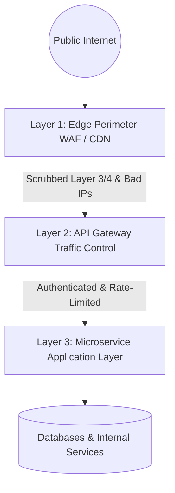
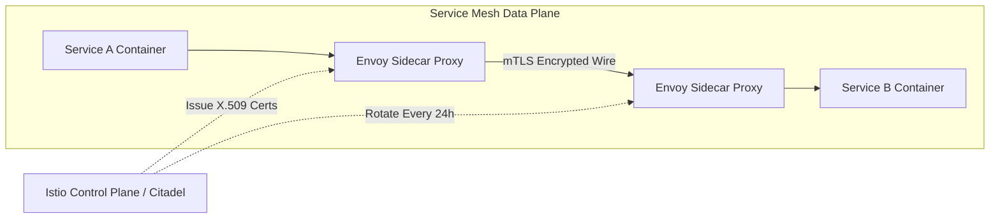
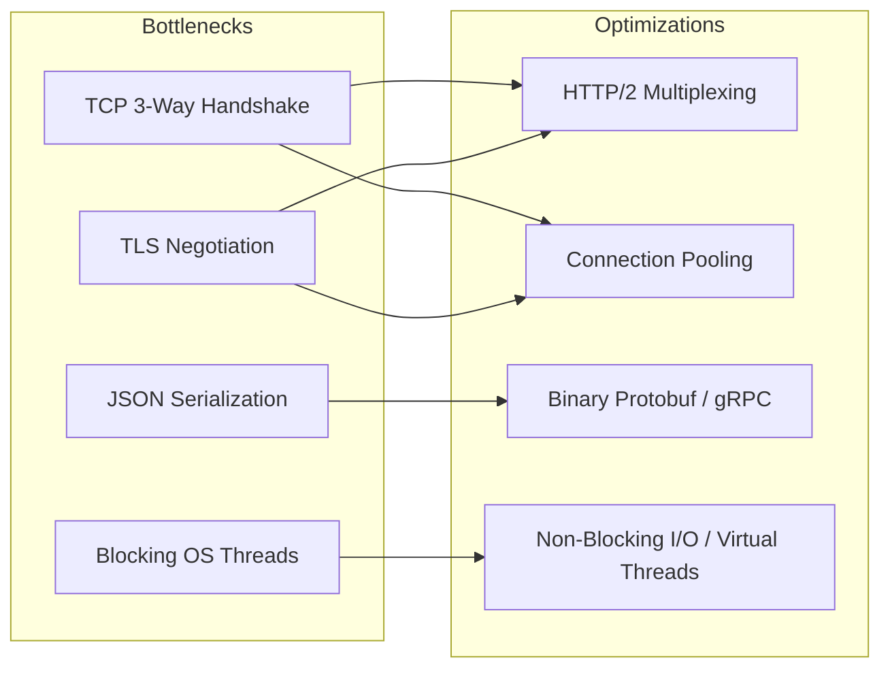

# Chapter 2: Security, Resilience & Traffic Management

## Traffic Management and Denial-of-Service Defense

### Defense-in-Depth Against DDoS and Abuse

#### Core Concept
Denial of Service (DoS) and Distributed Denial of Service (DDoS) attacks aim to cause resource exhaustion across CPU, memory, thread pools, network bandwidth, or database connection limits. Protecting distributed microservices requires a **defense-in-depth** strategy: traffic must be scrubbed, evaluated, and throttled across multiple operational layers before it can reach business logic.



#### Layer 1: Edge Perimeter (WAF & CDN)
- **Role:** Defends the infrastructure edge before traffic enters the private Virtual Private Cloud (VPC).
- **Technologies:** Cloudflare, AWS Shield Advanced, AWS WAF, Akamai.
- **Mechanisms:**
  - *Volumetric Mitigation (L3/L4):* Absorbs massive SYN floods, UDP reflection, and ICMP amplification attacks across globally distributed Anycast points-of-presence.
  - *Web Application Firewall (L7):* Inspects HTTP request headers and payloads against Open Web Application Security Project (OWASP) signatures (e.g., SQL injection, cross-site scripting, automated scraping bots).
  - *Geo-blocking & IP Reputation:* Drops traffic from known malicious IP ranges, Tor exit nodes, or regions outside business operating jurisdictions.

#### Layer 2: API Gateway Layer (Traffic Control)
- **Role:** Enforces operational access control and prevents downstream microservice saturation.
- **Technologies:** Spring Cloud Gateway, Kong, Envoy Proxy, Apigee.
- **Mechanisms:**
  - *Distributed Rate Limiting:* Enforces maximum request thresholds per client or token.
  - *Traffic Throttling & Shaping:* Smooths bursty traffic spikes by queueing requests rather than rejecting them immediately.
  - *Early Authentication Drops:* Rejects unauthorized requests (missing, invalid, or expired JWT tokens) at the perimeter, sparing downstream microservices from compute costs.

#### Layer 3: Application Layer (Self-Preservation)
- **Role:** Protects microservice runtime resources from legitimate-looking payloads designed to trigger algorithmic complexity attacks.
- **Mechanisms:**
  - *Strict Request Body Limits:* Restrict payload size (e.g., maximum 2 MB for JSON bodies, 10 MB for multipart file uploads).
  - *Mandatory Pagination Limits:* Enforce maximum bounds on database query parameters (e.g., capping `limit` to a maximum of 100 records per request) to prevent memory allocation denial-of-service.
  - *GraphQL Query Complexity / Depth Analysis:* Limit query nesting depth (e.g., max 4 levels) to prevent malicious cyclic queries that exhaust server CPU and database joins.
  - *Aggressive Timeouts:* Configure strict read and socket connect timeouts (e.g., 2–5 seconds) to defend against Slowloris attacks that hold HTTP connections open indefinitely.

---

### Distributed Rate Limiting and Throttling Algorithms

#### Rate Limiting vs. Throttling
- **Rate Limiting:** Rejects incoming requests that exceed a defined threshold within a given time frame, instantly returning `HTTP 429 Too Many Requests`.
- **Throttling:** Delays or buffers incoming requests that exceed the nominal threshold, allowing controlled bursts to process gradually through queues without dropping traffic.

#### Rate Limiting Algorithms Comparison

| Algorithm | How It Works | Strengths | Trade-offs & Limitations |
| :--- | :--- | :--- | :--- |
| **Fixed Window Counter** | Counts requests in fixed time slices (e.g., 100 req/minute). Counter resets at boundary. | Very low memory ($O(1)$); simple to implement in Redis (`INCR` + `EXPIRE`). | **Boundary Burst Hazard:** Can permit 2x the limit if 100 requests arrive at 00:59 and 100 requests arrive at 01:01. |
| **Sliding Window Log** | Records the exact timestamp of every request in a sorted set. Removes entries older than $(t - \text{window})$. | Mathematically exact; no boundary burst vulnerability. | High memory footprint ($O(N)$ stored timestamps per user); expensive Redis `ZREMRANGEBYSCORE`. |
| **Sliding Window Counter** | Blends the count of the previous window and the current window using an elapsed time weighting factor. | $O(1)$ memory; prevents boundary bursts; computationally lightweight. | Minor approximation error (assumes requests in previous window were uniformly distributed). |
| **Token Bucket** | Tokens accumulate in a bucket at a fixed rate up to capacity $C$. Each request consumes 1 token. | Accommodates short bursts up to bucket capacity while enforcing an average rate limit. | Requires tracking both timestamp and token count per bucket. |
| **Leaky Bucket** | Requests enter a fixed-size FIFO buffer and leak out at a constant, steady rate. Drops requests if full. | Completely smooths output rate; eliminates burstiness downstream. | Bursty traffic experiences high queueing latency; drops traffic when queue overflows. |

#### Client Identification Dimensions (The IP Trap)
Rate limiting solely by client IP address (`Remote-Addr` or `X-Forwarded-For`) is dangerous in enterprise environments:
- **Corporate NAT Gateways:** An entire office building or university campus with 10,000 legitimate users may share a single public IP. Limiting by IP will block legitimate users when one user triggers the threshold.
- **IP Spoofing:** Attackers can easily spoof IP headers across distributed botnets.
- **Architectural Best Practice:** Rate limit by authenticated identity:
  1. Authenticated traffic: User ID extracted from verified JWT claims (`sub`).
  2. Public/Partner traffic: Cryptographic API Key passed via header (`X-API-Key`).
  3. Anonymous traffic: Fallback to composite keys (`IP + User-Agent Hash`).

#### Standard HTTP Rate Limiting Headers
When an API responds, it communicates rate limit quotas using standardized headers:
- `X-RateLimit-Limit`: Maximum requests permitted within the current window (e.g., `1000`).
- `X-RateLimit-Remaining`: Remaining request allowance in current window (e.g., `245`).
- `X-RateLimit-Reset`: Unix epoch timestamp when the quota resets (e.g., `1716940800`).
- `Retry-After`: Returned with `HTTP 429 Too Many Requests` indicating the number of seconds the client must sleep before retrying.

#### Distributed Rate Limiting Implementation (Redis + Lua)
In a clustered microservice environment with dozens of stateless pods, in-memory rate limiters (e.g., Guava `RateLimiter`) fail because each instance maintains its own local memory, allowing $N \times \text{limit}$ requests across the cluster. A centralized, atomic Redis cache is required.

To prevent race conditions (check-then-act bugs), the increment and expiration must execute atomically inside a single **Redis Lua script**:

```java
package com.enterprise.ratelimiter;

import org.springframework.data.redis.core.StringRedisTemplate;
import org.springframework.data.redis.core.script.DefaultRedisScript;
import org.springframework.stereotype.Service;

import java.time.Instant;
import java.util.Collections;

@Service
public class DistributedRateLimiterService {

    private final StringRedisTemplate redisTemplate;

    // Atomic Lua Script: Increments count and applies TTL on the first hit.
    // Returns 1 if request is allowed, 0 if rate limit is exceeded.
    private static final String LUA_SCRIPT =
        "local count = redis.call('incr', KEYS[1]) " +
        "if count == 1 then " +
        "  redis.call('expire', KEYS[1], ARGV[1]) " +
        "end " +
        "if count > tonumber(ARGV[2]) then " +
        "  return 0 " +
        "end " +
        "return 1";

    public DistributedRateLimiterService(StringRedisTemplate redisTemplate) {
        this.redisTemplate = redisTemplate;
    }

    public boolean isAllowed(String userId, int maxRequests, int windowSeconds) {
        // Compute discrete time-bucketed window key (e.g., "rate:usr_9812:17169400")
        long currentWindow = Instant.now().getEpochSecond() / windowSeconds;
        String redisKey = "rate:" + userId + ":" + currentWindow;

        DefaultRedisScript<Long> script = new DefaultRedisScript<>(LUA_SCRIPT, Long.class);

        Long result = redisTemplate.execute(
            script,
            Collections.singletonList(redisKey), // KEYS[1]
            String.valueOf(windowSeconds),       // ARGV[1] (TTL)
            String.valueOf(maxRequests)          // ARGV[2] (Limit)
        );

        return result != null && result == 1L;
    }
}
```

---

## Microservices Security Architecture

### Inter-Service Security and Zero Trust

#### Perimeter Security vs. Zero Trust
- **Traditional Perimeter Model (Castle-and-Moat):** Strong firewall at the outer edge, but inside the private network (VPC), all internal East-West microservice traffic is unauthenticated and unencrypted. If an attacker breaches the perimeter or compromises a single container, the entire internal network is vulnerable.
- **Zero Trust Architecture:** Operates under the premise that the internal network is already compromised. *"Never trust, always verify."* Every single inter-service request must be authenticated, authorized, and encrypted in transit.



#### Mutual TLS (mTLS) with Service Mesh
- **Mechanics:** In standard TLS, only the server proves its identity to the client. In Mutual TLS (mTLS), both client and server exchange and validate cryptographic X.509 certificates during the TLS handshake.
- **Implementation via Service Mesh (Istio / Linkerd):**
  - Application containers do not manage certificates directly. Each pod runs an Envoy sidecar proxy.
  - The Service Mesh Control Plane acts as an internal Certificate Authority (CA), issuing and automatically rotating short-lived X.509 certificates to each sidecar proxy.
  - Transparent wire encryption: Service A talks to `localhost`, the Envoy sidecar intercepts traffic, initiates mTLS with Service B's sidecar, and decrypts it on the destination host.

#### Token Propagation and User Context
When an end-user triggers an action that cascades through multiple downstream microservices ($A \rightarrow B \rightarrow C$), services must preserve user identity and authorization scopes without sharing user credentials:
1. **JWT Header Propagation:** The API Gateway validates the client's credentials, mints or verifies the JSON Web Token (JWT), and forwards it in the `Authorization: Bearer <token>` header to downstream services.
2. **Stateless Verification:** Downstream microservices verify the token's cryptographic signature using the Identity Provider's public key (retrieved via JWKS - JSON Web Key Set) and extract roles/scopes without invoking the authentication server.
3. **Machine-to-Machine (M2M) OAuth2 Client Credentials:** For automated background jobs or asynchronous services operating without an active user session, microservices authenticate against an OAuth2 Authorization Server (e.g., Keycloak, Okta) using the Client Credentials grant to obtain a service-scoped JWT.

#### Network Isolation: Kubernetes NetworkPolicies
Zero Trust is reinforced at the container networking level using Kubernetes `NetworkPolicy` resources (powered by Calico or Cilium eBPF):
- **Default Deny Rule:** By default, all ingress and egress network traffic between namespaces and pods is blocked.
- **Explicit Allow Rules:** Developers must declare explicit whitelists permitting traffic only between authorized services on specific ports (e.g., Order Service is permitted to send TCP traffic to Payment Service on port 8080, but all other egress is rejected).

---

## Ecosystem Infrastructure and Latency Optimization

### Dynamic Service Discovery and Registration

#### Why Dynamic Discovery is Mandatory
In monolithic architectures, services communicated over fixed, static IP addresses or internal domain names. In containerized cloud environments (Kubernetes, AWS ECS):
- Containers scale up and down elastically.
- Pods are ephemeral; nodes fail, and pods are rescheduled onto different physical hosts with dynamically assigned private IP addresses.
- Static IP configuration causes immediate communication failure. A dynamic **Service Registry** is required to map service names to live, healthy host/port endpoints.

#### Client-Side vs. Server-Side Service Discovery

```mermaid
flowchart TD
    subgraph Client-Side Discovery (Eureka)
        Client1[Service A Client] -->|1. Query Endpoints| Registry[Service Registry / Eureka]
        Registry -.->|"Return: IP1, IP2"| Client1
        Client1 -->|"2. Direct Request (Client LB)"| Inst1[Service B: Instance 1]
    end

    subgraph Server-Side Discovery (Kubernetes)
        Client2[Service A Client] -->|1. Invoke 'http://order-service'| K8sProxy[K8s Service / Kube-Proxy]
        K8sProxy -->|2. Forward to healthy pod| Pod2[Service B Pod]
        K8sControl[K8s Control Plane] -.->|Update Endpoints| K8sProxy
    end
```

| Dimension | Client-Side Discovery (e.g., Netflix Eureka + Spring Cloud) | Server-Side Discovery (e.g., Kubernetes Services + CoreDNS) |
| :--- | :--- | :--- |
| **Mechanics** | Client queries the registry directly, caches instances locally, and executes client-side load balancing (Round Robin, Least Active). | Client sends request to a static virtual IP or DNS name. An intermediate proxy (Kube-Proxy/ALB) routes to healthy instances. |
| **Language Coupling** | High. Requires client-side library integration (Java/Spring Cloud LoadBalancer). | None. Completely polyglot; works with any runtime via standard DNS lookups. |
| **Network Hops** | Direct point-to-point connection after initial lookup (lower latency). | Introduces an extra hop or routing layer via reverse proxy / virtual IP tables. |
| **Failure Tolerance** | High resilience: If the registry goes down, clients can still route traffic using locally cached instance lists. | High resilience if the container platform control plane (etcd / kube-proxy) is highly available. |

#### Health Checks and Self-Healing
Service registries prevent routing traffic to degraded instances using active health checking:
- **Heartbeat Checks:** Microservice instances send periodic ping signals (e.g., every 10 seconds). If a threshold of heartbeats is missed, the registry removes the instance from routing tables.
- **Liveness Probes:** Evaluates if the container process is running. If deadlocked, Kubernetes restarts the container.
- **Readiness Probes:** Evaluates if the microservice is fully initialized and capable of accepting traffic (e.g., database connection pool established, caches warm). Prevents routing traffic to cold-starting pods.

---

### Performance Tuning and Latency Reduction

#### The Latency Tax in Distributed Systems
Transitioning from in-memory monolithic method calls to network-bound microservices introduces significant serialization, connection establishment, and transport overhead. Mitigating this tax requires optimization across the network and application stack:



#### High-Impact Performance Strategies
1. **Aggressive Connection Pooling:**
   - Establishing a new TCP connection requires a 3-way handshake (~1 RTT) plus TLS handshake (1–2 RTTs).
   - Reuse long-lived persistent connections for HTTP and databases via configured pools (HikariCP for SQL, Apache HttpClient / Reactor Netty connection pools for HTTP clients).
2. **HTTP/2 Connection Multiplexing:**
   - Replaces HTTP/1.1 head-of-line blocking by interleaving multiple concurrent bidirectional streams over a single TCP connection.
3. **Binary Serialization (gRPC / Protobuf):**
   - Eliminates the parsing and bandwidth overhead of verbose JSON text strings. Binary payloads reduce payload size by 60–80% and deserialize up to 10x faster.
4. **Compression Policies:**
   - Enable Gzip or Brotli compression for HTTP response bodies above a sensible size threshold (e.g., > 1 KB). Avoid compressing tiny payloads, as CPU compression overhead exceeds network transmission gains.
5. **Asynchronous Event-Driven Offloading:**
   - Eliminate synchronous waiting chains by moving side-effect operations (audit logging, email dispatch, metrics reporting) to asynchronous Kafka message publishers.
