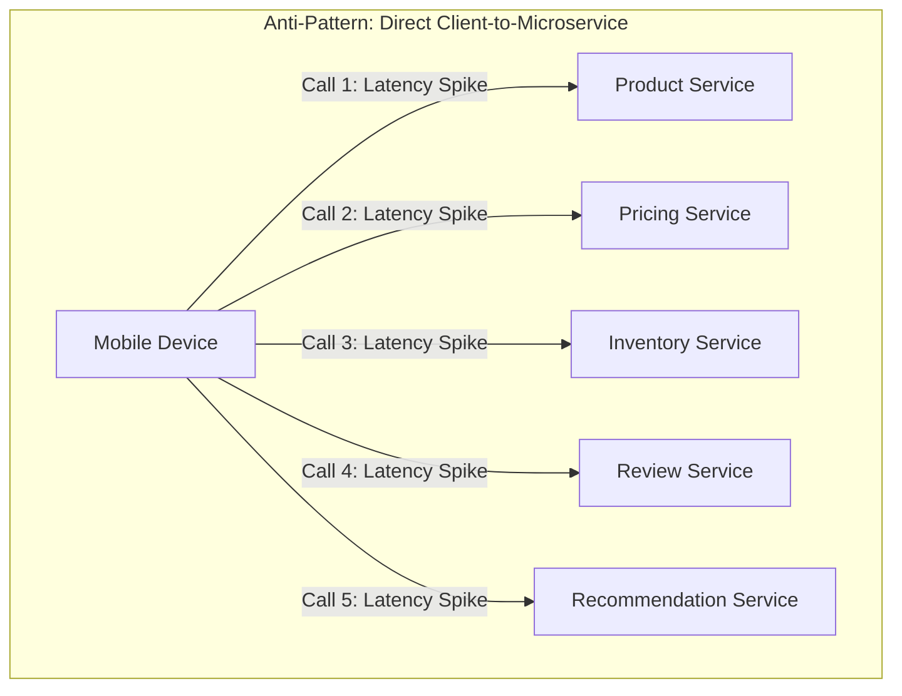
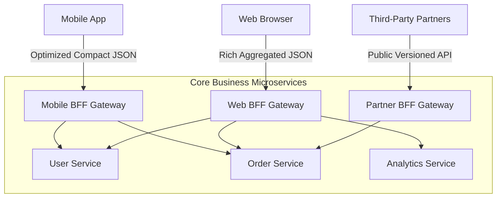
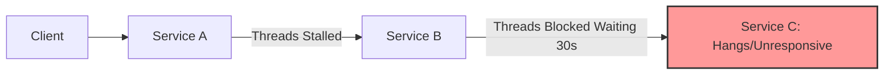
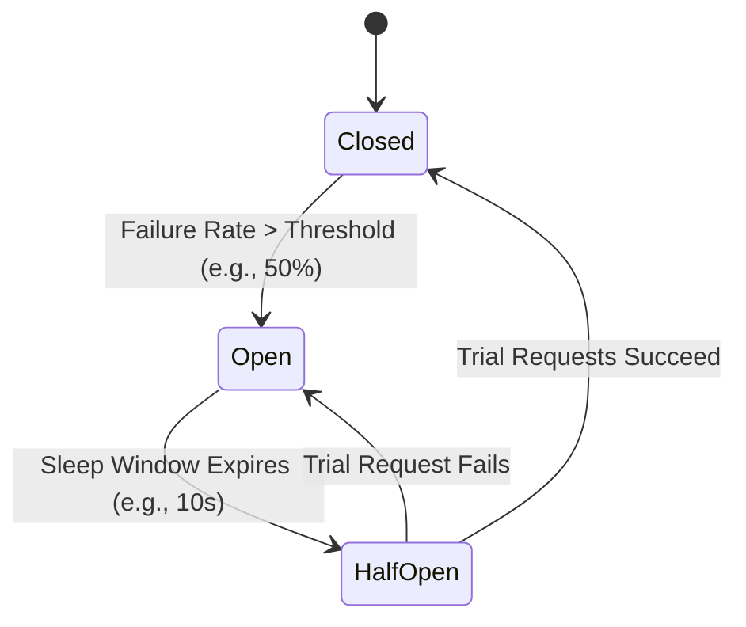
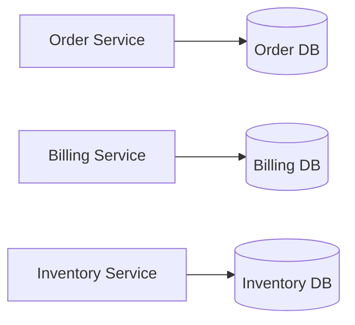
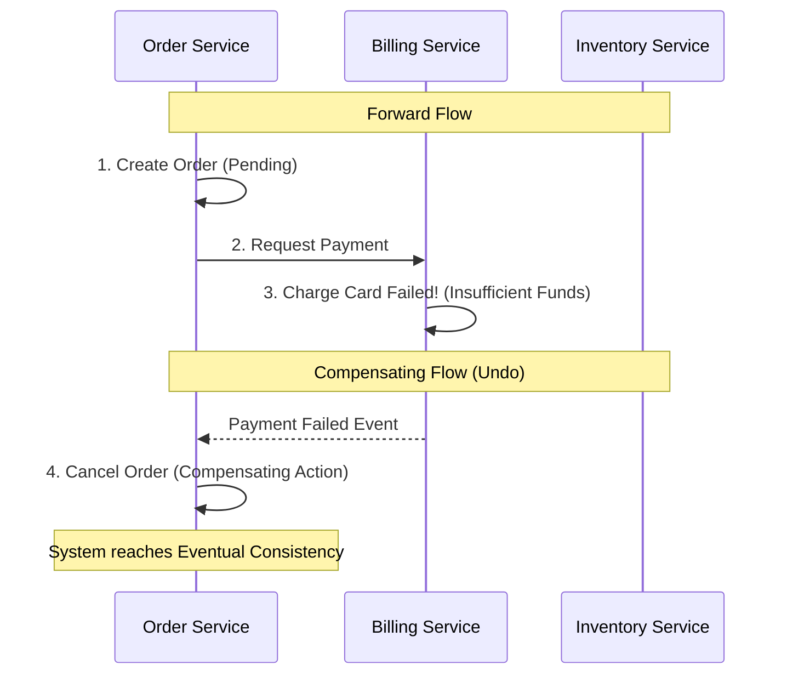
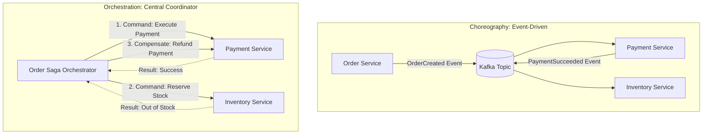
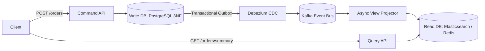

# Chapter 3: Distributed Architecture Patterns

## Gateway and Edge Routing Patterns

### API Gateway and Backend-For-Frontend Pattern

#### 1. The Core Problem: The Chatty Client and Distributed Chaos
In a distributed microservices ecosystem, client frontends (web apps, mobile apps, IoT devices) must assemble data from multiple autonomous backend services. For example, rendering a modern Amazon Product Page requires data from the Product Service, Pricing Service, Inventory Service, Review Service, and Recommendation Service.



Allowing clients to invoke microservices directly creates severe architectural liabilities:
- **The Network Penalty (The N+1 Client Problem):** Over cellular networks (4G/5G) with high round-trip latency (50–100 ms RTT), making 5–10 sequential or parallel HTTP calls severely degrades user experience. Total page load latency accumulates rapidly.
- **The Payload Penalty:** A desktop web dashboard with high-bandwidth broadband and large display screens demands rich, detailed payloads. A mobile application requires compact payloads to preserve battery life and cellular data. Directly exposing internal backend DTOs results in massive data over-fetching or under-fetching.
- **Security & Topography Exposure:** Exposing internal microservice IP addresses, ports, and domain structures directly to the public internet dramatically expands the attack surface.
- **Protocol Mismatch:** Internal microservices frequently communicate over high-performance binary protocols (gRPC/Protobuf), which are poorly suited for native web browser clients that require HTTP/JSON.

#### 2. The Mechanics: The Reverse Proxy on Steroids
An **API Gateway** acts as the single, unified ingress entry point for all external client traffic.

```mermaid
flowchart LR
    Client["Web & Mobile Clients"] -->|Single HTTPS Endpoint| Gateway[API Gateway]
    subgraph Internal VPC (Private Network)
        Gateway -->|Internal Routing| Svc1[Product Service]
        Gateway -->|Internal Routing| Svc2[Pricing Service]
        Gateway -->|Internal Routing| Svc3[Inventory Service]
        Gateway -->|Internal Routing| Svc4[Review Service]
    end
```

The API Gateway centralizes mission-critical cross-cutting capabilities:
1. **Request Routing & Dynamic Reverse Proxying:** Inspects incoming URI paths, headers, or query parameters and proxies requests to healthy internal container endpoints resolved via the Service Registry.
2. **API Aggregation (Composition):** Accepts a single incoming request from a client, dispatches concurrent downstream calls to multiple backend microservices, combines their responses into a single consolidated JSON payload, and returns it to the client in one round trip.
3. **Cross-Cutting Policy Enforcement:** Offloads SSL/TLS termination, distributed rate limiting, CORS configuration, API key validation, and authentication verification from backend microservices.
4. **Protocol Translation:** Bridges external client HTTP/1.1 JSON calls into internal high-performance East-West gRPC binary streams.

#### 3. The Backend-For-Frontend (BFF) Pattern
As an enterprise ecosystem scales to support distinct client personas, a single monolithic API Gateway becomes a multi-team deployment bottleneck. The **Backend-For-Frontend (BFF)** pattern resolves this by deploying dedicated, fine-grained gateways tailored to each client type:



- **The Mobile BFF:** Owned and maintained by mobile engineers. It aggressively strips unused fields, converts large image URLs to low-resolution thumbnails, and consolidates multiple calls into a single lightweight payload to optimize battery and mobile network performance.
- **The Web BFF:** Owned by web frontend teams. It exposes richer, deeply nested data models supporting high-resolution desktop views, server-side rendering (SSR), and advanced dashboard filters.

#### 4. Implementation: Reactive Aggregation with Spring Cloud Gateway & WebClient
Senior architects avoid blocking synchronous aggregation. When an API Gateway stitches multiple microservice calls together, it must invoke them concurrently using non-blocking reactive streams (Spring WebClient and Project Reactor):

```java
package com.enterprise.gateway.service;

import com.enterprise.gateway.dto.*;
import org.springframework.stereotype.Service;
import org.springframework.web.reactive.function.client.WebClient;
import reactor.core.publisher.Mono;

import java.util.List;

@Service
public class DashboardAggregatorService {

    private final WebClient userClient;
    private final WebClient orderClient;
    private final WebClient reviewClient;

    public DashboardAggregatorService(WebClient.Builder webClientBuilder) {
        this.userClient = webClientBuilder.baseUrl("http://user-service").build();
        this.orderClient = webClientBuilder.baseUrl("http://order-service").build();
        this.reviewClient = webClientBuilder.baseUrl("http://review-service").build();
    }

    public Mono<UserDashboardDto> getAggregatedDashboard(String userId) {
        // Dispatch all three downstream network calls concurrently
        Mono<UserProfileDto> userMono = userClient.get()
                .uri("/users/{id}", userId)
                .retrieve()
                .bodyToMono(UserProfileDto.class);

        Mono<List<OrderSummaryDto>> ordersMono = orderClient.get()
                .uri("/orders?userId={id}", userId)
                .retrieve()
                .bodyToFlux(OrderSummaryDto.class)
                .collectList();

        Mono<List<ReviewSummaryDto>> reviewsMono = reviewClient.get()
                .uri("/reviews?userId={id}", userId)
                .retrieve()
                .bodyToFlux(ReviewSummaryDto.class)
                .collectList();

        // Non-blocking zip: wait for all parallel calls to complete, then assemble
        return Mono.zip(userMono, ordersMono, reviewsMono)
                .map(tuple -> new UserDashboardDto(
                        tuple.getT1(), // UserProfileDto
                        tuple.getT2(), // List<OrderSummaryDto>
                        tuple.getT3()  // List<ReviewSummaryDto>
                ));
    }
}
```

#### 5. Architectural Trap: The "God Object" Gateway
The most critical anti-pattern in Gateway design is embedding business logic into the gateway layer.
- **The Risk:** Developers start placing conditional business rules inside the gateway (e.g., `if (user.isGoldMember) { calculateDiscount() }`). Over time, the gateway becomes an unmaintainable, tightly coupled monolithic bottleneck.
- **The Architectural Rule:** The API Gateway must remain **"Dumb"**. It should strictly handle transport-level routing, non-blocking payload aggregation, authentication verification, and rate limiting. It must never contain business domain rules, transactional state machines, or direct database access.

---

## Fault Tolerance and Systemic Resiliency Patterns

### Circuit Breaker and Cascading Failure Prevention

#### 1. The Core Problem: Cascading Failures & Thread Pool Exhaustion
In a distributed microservice network, failure is inevitable. When downstream Service C becomes unresponsive (e.g., hanging due to database connection starvation or memory thrashing), upstream Service B continues forwarding incoming requests to Service C.



- Each pending network request occupies an active Tomcat or worker thread in Service B.
- Within seconds, Service B exhausts its thread pool.
- Service B can no longer accept new incoming requests, even for unrelated endpoints that do not depend on Service C.
- Service A then stalls waiting for Service B, propagating thread exhaustion up the call chain until the entire enterprise architecture collapses in a **cascading outage**.

#### 2. The Mechanics: The Circuit Breaker State Machine
The Circuit Breaker pattern sits between the calling service and the remote dependency. It acts like an electrical circuit breaker in a home, monitoring failure rates and tripping automatically to isolate faults.



The state machine operates across three distinct operational states:
1. **CLOSED (Normal Operation):**
   - Requests execute normally against the downstream service.
   - The breaker measures execution outcomes (successes, errors, slow calls) within a configurable sliding window (count-based or time-based).
   - If the error rate or slow-call rate remains below the configured threshold, the breaker remains CLOSED.
2. **OPEN (Failing Fast):**
   - When the error percentage exceeds the configured threshold (e.g., $\ge 50\%$ failures or response times $> 2000$ ms), the circuit breaker trips to OPEN.
   - All subsequent calls fail immediately at the local proxy level without touching the network or allocating I/O threads.
   - The breaker immediately invokes a local fallback method or returns a cached default, completely shielding the downstream service from traffic so it can recover.
3. **HALF-OPEN (Trial Probe):**
   - After a configured sleep duration (e.g., 10 seconds), the breaker transitions to HALF-OPEN.
   - It permits a strictly limited number of trial requests (e.g., 10 requests) to pass through to the downstream service.
   - If the trial requests succeed, the breaker automatically resets to **CLOSED**.
   - If any trial request fails or times out, the breaker immediately returns to **OPEN** for another sleep cycle.

#### 3. Implementation: Spring Boot & Resilience4j
Resilience4j is the lightweight, thread-safe, functional fault-tolerance framework designed for Java 17/21 and Spring Boot.

**`application.yml` Production Configuration:**
```yaml
resilience4j:
  circuitbreaker:
    instances:
      paymentServiceBreaker:
        slidingWindowType: COUNT_BASED
        slidingWindowSize: 20
        minimumNumberOfCalls: 10
        failureRateThreshold: 50.0
        slowCallRateThreshold: 75.0
        slowCallDurationThreshold: 2000ms
        waitDurationInOpenState: 10000ms
        permittedNumberOfCallsInHalfOpenState: 5
        automaticTransitionFromOpenToHalfOpenEnabled: true
```

**Spring Service Implementation with Fallback:**
```java
package com.enterprise.order.service;

import io.github.resilience4j.circuitbreaker.annotation.CircuitBreaker;
import org.slf4j.Logger;
import org.slf4j.LoggerFactory;
import org.springframework.stereotype.Service;
import org.springframework.web.client.RestTemplate;

@Service
public class OrderPaymentService {

    private static final Logger log = LoggerFactory.getLogger(OrderPaymentService.class);
    private final RestTemplate restTemplate;

    public OrderPaymentService(RestTemplate restTemplate) {
        this.restTemplate = restTemplate;
    }

    @CircuitBreaker(name = "paymentServiceBreaker", fallbackMethod = "executePaymentFallback")
    public PaymentResponse processPayment(PaymentRequest request) {
        // Synchronous network call guarded by Resilience4j
        return restTemplate.postForObject("http://payment-service/api/v1/payments", request, PaymentResponse.class);
    }

    // Fallback method MUST match parameter signature + Throwable
    public PaymentResponse executePaymentFallback(PaymentRequest request, Throwable t) {
        log.warn("Payment service unavailable or slow. Tripping fallback. Reason: {}", t.getMessage());
        return new PaymentResponse(
            request.getOrderId(),
            PaymentStatus.QUEUED_FOR_OFFLINE_PROCESSING,
            "Payment recorded. Will be processed asynchronously upon system recovery."
        );
    }
}
```

#### 4. Systemic Resiliency Synergies: Retry vs. Circuit Breaker vs. Bulkhead
Enterprise resiliency requires orchestrating complementary fault-tolerance patterns:

- **Retry Pattern:**
  - *Purpose:* Designed exclusively for **transient, momentary glitches** (e.g., a 100 ms network packet hiccup or transient socket reset).
  - *Mandatory Rules:* Always apply exponential backoff and random jitter. Never retry non-idempotent mutations (`POST` payment charges) without unique idempotency keys.
  - *The Trap:* Retrying during a hard downstream outage acts as a self-inflicted Distributed Denial of Service attack, driving the failing service deeper into saturation.
- **Circuit Breaker Pattern:**
  - *Purpose:* Designed for **systemic, long-duration outages**. Stops retrying and cuts off network traffic entirely.
- **Bulkhead Pattern:**
  - *Purpose:* Isolates system resources (thread pools or concurrent semaphores) into isolated compartments (analogous to the watertight bulkheads of a ship).
  - If the Payment Service thread pool is fully exhausted, the Catalog Service thread pool remains completely unaffected.

---

## Distributed Transactions and Event-Driven Patterns

### Saga Pattern and Distributed Transaction Management

#### 1. The Core Problem: The Death of the Global ACID Transaction
In a monolithic system with a single centralized relational database, managing multi-step workflows is trivial: wrap the entire operation inside an ACID database transaction (`@Transactional`). If any step fails, the database rollback reverts all mutations automatically.

In a microservices architecture, the **Database-per-Service** pattern dictates that every microservice owns its private database:



- When placing an order, the system must:
  1. Create an Order (Order Service / PostgreSQL).
  2. Reserve Customer Funds (Billing Service / Oracle).
  3. Reserve Warehouse Stock (Inventory Service / MongoDB).
- **The 2PC (Two-Phase Commit) Anti-Pattern:** Attempting to coordinate transactions across independent databases using distributed 2PC/XA transactions is an architectural anti-pattern. 2PC holds locks across network boundaries for the duration of the entire distributed transaction, introducing extreme latency, vulnerability to network partitions, and a critical single point of failure (the transaction coordinator).

#### 2. The Mechanics: Local Transactions & Compensating Logic
The **Saga Pattern** completely abandons the illusion of a distributed ACID transaction. Instead, a Saga models a distributed business transaction as a sequence of discrete **Local ACID Transactions**:
1. **The Forward Execution Flow:** Each service executes its own local transaction, commits its changes directly to its private database, and emits an event or message to trigger the next step.
2. **The Compensating Flow (Rollback):** If a local transaction fails at step $N$ (e.g., customer has insufficient credit at Step 2), the Saga must explicitly execute **Compensating Transactions** (undo actions) in reverse order for steps $N-1$ down to 1.



- *Crucial Rule:* A compensating transaction is not a physical rollback; it is a business compensation that reconciles state (e.g., refunding a credit card rather than un-writing database logs).

#### 3. Saga Implementation Flavors: Choreography vs. Orchestration



| Dimension | Choreography-Based Saga | Orchestration-Based Saga |
| :--- | :--- | :--- |
| **Mechanics** | Decentralized. Services react to domain events published to a message broker (Kafka). | Centralized. A dedicated orchestrator state machine sends explicit commands to participant services. |
| **Coupling** | Loose coupling. Services do not know about each other. | Orchestrator holds explicit references and command contracts for all participant services. |
| **Best Used For** | Simple workflows (2 to 4 steps) with minimal conditional branching. | Complex, long-running enterprise business processes (5+ steps, nested loops, conditional rollbacks). |
| **Observability** | Difficult. Tracing the status of an ongoing transaction requires querying logs across multiple services. | Excellent. The orchestrator maintains the single source of truth for the entire workflow state. |
| **Failure Risks** | **Event Spaghetti:** High risk of cyclic event loops and unreadable dependency chains ("Event Mirage"). | **God Service:** High risk of developers cramming business domain logic into the orchestrator coordinator. |

---

### CQRS and Event Sourcing

#### 1. The Core Problem: The CRUD Bottleneck
In traditional database design, the same data model (typically relational third-normal-form 3NF) is utilized for both writes (INSERT, UPDATE) and reads (SELECT). In high-volume systems, this creates an irreconcilable architectural conflict:
- **Write Requirements:** Demand strict schema validation, foreign key constraints, row locking, and normalized tables to eliminate data redundancy and guarantee ACID consistency.
- **Read Requirements:** High-traffic dashboards and user interfaces (e.g., 100,000 queries/sec) demand denormalized, pre-aggregated, index-heavy views without expensive SQL table joins.
- Forcing both workloads onto the same database causes write locks to block dashboard queries, while heavy analytical queries starve transactional updates.

#### 2. The Mechanics: Splitting Command and Query Models
**CQRS (Command Query Responsibility Segregation)** completely decouples the system into two distinct architectural paths:



1. **Command Model (Write Path):**
   - Strictly handles intent-driven mutations (`CreateOrderCommand`, `CancelOrderCommand`).
   - Executes business domain rules, validates invariants, and commits minimal, normalized records to an ACID transactional datastore (e.g., PostgreSQL).
   - Never returns rich query models; returns `void`, `202 Accepted`, or an entity ID.
2. **Query Model (Read Path):**
   - Strictly handles read requests (`GetUserOrdersQuery`).
   - Returns pre-materialized, denormalized view DTOs optimized for UI presentation.
   - Powered by read-optimized datastores (Elasticsearch for full-text search, Redis for sub-millisecond key-value lookups, or MongoDB for document views).
3. **The Event-Driven Synchronization Bridge:**
   - Changes in the Write DB are published as domain events to a message bus (Kafka) via the Transactional Outbox pattern.
   - Dedicated **View Projectors** consume events asynchronously and update the Read DB views.

#### 3. Architectural Trade-offs & Eventual Consistency
- **Eventual Consistency:** Because synchronization across the event bus occurs asynchronously, there is a sub-second propagation delay (typically 10–500 ms). If a user writes data and immediately refreshes their dashboard, the Read DB may serve stale data for a few milliseconds.
- **Complexity Cost:** CQRS introduces dual database maintenance, schema synchronization pipelines, and event serialization overhead. It is justified only when read volume drastically exceeds write volume or query shapes diverge fundamentally from transactional models.
- **Synergy with Event Sourcing:** CQRS is commonly paired with **Event Sourcing**, where the Write DB does not store current state, but rather an append-only log of immutable business events (`OrderCreated`, `PaymentCaptured`, `OrderShipped`). The current state of any entity is reconstructed by replaying its historical event stream.
