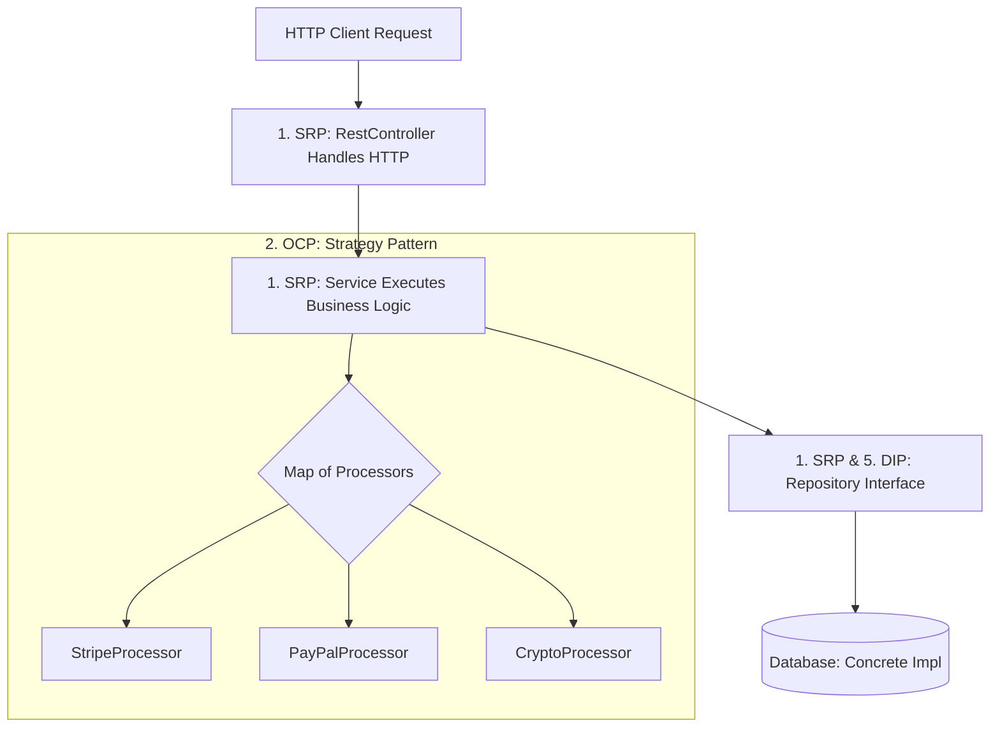

# Chapter 4: SOLID Principles & Enterprise Patterns

## Object-Oriented SOLID Principles

### Theoretical Foundations and Architectural Rules

#### Core Concept
The SOLID principles, formulated by Robert C. Martin (Uncle Bob), represent five foundational design tenets that govern object-oriented and modular system design. In enterprise architectures, adherence to SOLID prevents codebase degradation (rigidity, fragility, immobility, and viscosity), ensuring that software systems can scale across hundreds of developers without accumulating paralyzing technical debt.

```
S — Single Responsibility Principle (SRP)
O — Open/Closed Principle (OCP)
L — Liskov Substitution Principle (LSP)
I — Interface Segregation Principle (ISP)
D — Dependency Inversion Principle (DIP)
```

---

#### 1. Single Responsibility Principle (SRP)
- **The Core Problem:** The "God Class" anti-pattern. In monolithic enterprise codebases, a single class frequently accumulates multiple orthogonal concerns. For example, a `TradeService` class that computes mathematical risk models, persists trade records to an Oracle database, and formats/dispatches customer email alerts.
- **The Threat:** When risk calculation algorithms change, developers edit `TradeService`. When email templates change, developers edit the same file. When database schemas change, developers edit it again. This creates massive merge conflicts, cross-concern regressions, and untestable code.
- **The Architect's Rule:** *"A class should have one, and only one, reason to change."* Each class should be responsible to a single stakeholder or actor (e.g., Risk Officers vs. Database Administrators vs. Marketing).
- **Fintech Enterprise Solution:** Decompose the God Class into single-responsibility collaborators:
  - `TradeRiskCalculator`: Owns mathematical risk and margin calculations.
  - `TradeRepository`: Owns data persistence and transaction management.
  - `TradeNotificationService`: Owns customer alerting and communication formatting.

---

#### 2. Open/Closed Principle (OCP)
- **The Core Problem:** Fragile, regression-prone codebases. When business analysts request support for a new payment method (e.g., Apple Pay), junior developers modify a core `PaymentService` class by appending another branch to a 500-line `switch` or `if-else` chain.
- **The Threat:** Every new feature requires modifying and re-testing critical existing code that is already stable in production. A typo or misplaced bracket in the new `if` branch can break existing Visa or Mastercard payment processing.
- **The Architect's Rule:** *"Software entities (classes, modules, functions) should be open for extension, but closed for modification."* You should be able to introduce entirely new business behaviors without altering existing, production-tested source code.
- **Fintech Enterprise Solution:** Define an immutable abstraction interface (`PaymentProcessor`) and implement the **Strategy Pattern**. Each payment gateway (Visa, Stripe, PayPal, Apple Pay) is implemented as an autonomous class fulfilling the contract. Adding a new gateway requires writing a new class; existing classes remain untouched.

---

#### 3. Liskov Substitution Principle (LSP)
- **The Core Problem:** Broken abstractions and behavioral degradation. Subclasses override base class methods in ways that violate parent contracts or semantic invariants, often throwing runtime exceptions for unsupported features.
- **The Classic Example:** A base class `BankAccount` exposes a `withdraw(amount)` method. A developer introduces a subclass `FixedDepositAccount` (certificate of deposit). Because early withdrawals are legally forbidden, the developer implements `withdraw()` as:
  ```java
  // Anti-Pattern: Violates Liskov Substitution Principle
  @Override
  public void withdraw(BigDecimal amount) {
      throw new UnsupportedOperationException("Withdrawals forbidden on Fixed Deposit!");
  }
  ```
- **The Threat:** Polymorphism breaks completely. Any upstream accounting service that iterates over a `List<BankAccount>` and calls `withdraw()` will crash in production with an unexpected runtime exception.
- **The Architect's Rule:** *"Subtypes must be substitutable for their base types without altering the correctness of the program."* A subclass must honor all pre-conditions, post-conditions, and behavioral guarantees declared by its parent class.
- **Fintech Enterprise Solution:** Redesign the class hierarchy. Do not force classes into unnatural parent-child relationships. Extract a common `Account` interface for balances and statements, and introduce a separate `WithdrawableAccount` interface specifically for accounts that permit fund withdrawals.

---

#### 4. Interface Segregation Principle (ISP)
- **The Core Problem:** The "Fat Interface" anti-pattern. System architects define large, monolithic interfaces that attempt to cover every conceivable operation in a business domain.
  ```java
  // Anti-Pattern: Fat Interface
  public interface OrderOperations {
      void createOrder(Order order);
      void executeTrade(Order order);
      void generateAuditReportCsv();
      void reconcileDailyLedger();
  }
  ```
- **The Threat:** A simple mobile order-placement service that only needs to create orders is forced to implement dummy methods or throw `UnsupportedOperationException` for ledger reconciliation and CSV reporting. Any change to the audit reporting method signature forces recompilation of the order-placement service.
- **The Architect's Rule:** *"Clients should not be forced to depend upon interfaces that they do not use."* Many client-specific, fine-grained interfaces are vastly superior to a single general-purpose interface.
- **Fintech Enterprise Solution:** Segregate the interface into focused contracts:
  - `OrderCreationService`: `void createOrder(Order order);`
  - `TradeExecutionService`: `void executeTrade(Order order);`
  - `LedgerReconciliationService`: `void reconcileDailyLedger();`

---

#### 5. Dependency Inversion Principle (DIP)
- **The Core Problem:** Tight coupling between high-level business logic and low-level infrastructure. A high-level financial calculation service directly instantiates and calls concrete low-level database drivers or network clients (`new OracleDatabaseConnection()`, `new SendGridEmailClient()`).
- **The Threat:** Business logic cannot be tested in isolation without a live Oracle database running. Migrating from Oracle to Amazon DynamoDB or PostgreSQL requires rewriting and re-verifying core financial business algorithms.
- **The Architect's Rule:**
  1. *"High-level modules should not depend on low-level modules. Both should depend on abstractions."*
  2. *"Abstractions should not depend on details. Details (concrete implementations) should depend on abstractions."*
- **Fintech Enterprise Solution:** The high-level `TradeProcessingService` depends exclusively on an abstract interface `TradeRepository`. The low-level database class `PostgreSqlTradeRepository` implements that interface. The dependency arrow is inverted: infrastructure depends on domain contracts, not vice versa.

#### The Senior Architect's One-Liner for the Interview
*"SOLID principles are not academic dogma; they are risk-mitigation strategies. SRP isolates the blast radius of change; OCP enables zero-downtime feature additions; LSP prevents behavioral regressions in polymorphic hierarchies; ISP eliminates interface pollution; and DIP inverts dependencies to decouple business rules from infrastructure details."*

---

### Enterprise Java and Spring Framework Implementation

The Spring Framework is an architectural manifestation of the SOLID principles. Understanding how Spring translates these principles into enterprise production code is a cornerstone of senior engineering leadership:



#### 1. SRP in Enterprise Spring: Controller-Service-Repository Layering
Spring enforces the Single Responsibility Principle through standard layer architecture:
- **`@RestController` (Web Layer):** Exclusively responsible for HTTP protocol concerns: deserializing incoming JSON, parsing path parameters, validating DTO constraints (`@Valid`), and mapping exceptions to HTTP status codes (RFC 7807). It contains zero business logic.
- **`@Service` (Domain Layer):** Exclusively responsible for core business invariants, calculation algorithms, and transaction boundary coordination (`@Transactional`). It has zero knowledge of HTTP headers, servlets, or REST endpoints.
- **`@Repository` (Persistence Layer):** Exclusively responsible for object-relational mapping, executing SQL/HQL queries, and translating raw database vendor error codes into Spring's unified `DataAccessException` hierarchy.

#### 2. OCP in Enterprise Spring: Spring-Managed Strategy Pattern
Rather than modifying a core service when introducing new processing algorithms, Spring's Dependency Injection container automatically enables the Open/Closed Principle via map-based polymorphism:

```java
package com.enterprise.payment.strategy;

import org.springframework.stereotype.Component;
import java.math.BigDecimal;

// The Strategy Interface (Immutable Abstraction)
public interface PaymentStrategy {
    PaymentType getSupportedType();
    PaymentResult process(BigDecimal amount, String accountId);
}

// Concrete Strategy A
@Component
public class StripePaymentStrategy implements PaymentStrategy {
    @Override
    public PaymentType getSupportedType() { return PaymentType.CREDIT_CARD; }

    @Override
    public PaymentResult process(BigDecimal amount, String accountId) {
        // Stripe integration logic
        return new PaymentResult(true, "Stripe-TX-1092");
    }
}

// Concrete Strategy B
@Component
public class CryptoPaymentStrategy implements PaymentStrategy {
    @Override
    public PaymentType getSupportedType() { return PaymentType.CRYPTO; }

    @Override
    public PaymentResult process(BigDecimal amount, String accountId) {
        // Blockchain transfer logic
        return new PaymentResult(true, "0x981a...bc");
    }
}
```

**The Context Service Closed for Modification:**
```java
package com.enterprise.payment.service;

import com.enterprise.payment.strategy.*;
import org.springframework.stereotype.Service;

import java.math.BigDecimal;
import java.util.List;
import java.util.Map;
import java.util.function.Function;
import java.util.stream.Collectors;

@Service
public class PaymentExecutionService {

    private final Map<PaymentType, PaymentStrategy> strategies;

    // Spring automatically injects all beans implementing PaymentStrategy into the List
    public PaymentExecutionService(List<PaymentStrategy> strategyList) {
        this.strategies = strategyList.stream()
            .collect(Collectors.toMap(PaymentStrategy::getSupportedType, Function.identity()));
    }

    public PaymentResult executePayment(PaymentType type, BigDecimal amount, String accountId) {
        PaymentStrategy strategy = strategies.get(type);
        if (strategy == null) {
            throw new IllegalArgumentException("Unsupported payment type: " + type);
        }
        // Open for extension: Adding ApplePay requires creating ApplePayStrategy.
        // This execution service is NEVER modified.
        return strategy.process(amount, accountId);
    }
}
```

#### 3. LSP in Enterprise Spring: Contract Integrity Over Hierarchy
In Spring enterprise systems, developers prevent Liskov Substitution violations by:
- Avoiding `UnsupportedOperationException` within service overrides.
- Favoring **Composition over Inheritance**: Instead of subclassing concrete Spring services, inject them as private fields within a new class.
- Ensuring that child classes do not strengthen pre-conditions (e.g., throwing unexpected validation errors not declared by the interface) or weaken post-conditions (e.g., returning `null` when the interface specifies non-null collections).

#### 4. ISP in Enterprise Spring: Fine-Grained Spring Data Repositories
Rather than exposing all CRUD operations to every service, Spring Data allows segregation of read and write capabilities:
```java
// Read-Only Interface for High-Traffic Reporting Service
public interface UserReadOnlyRepository extends org.springframework.data.repository.Repository<User, Long> {
    Optional<User> findById(Long id);
    List<User> findByStatus(UserStatus status);
}

// Write/Mutation Interface for Admin Maintenance Service
public interface UserAdminRepository extends org.springframework.data.jpa.repository.JpaRepository<User, Long> {
    // Inherits save, delete, flush, deleteAllInBatch
}
```
A reporting service depends strictly on `UserReadOnlyRepository`, preventing reporting developers from accidentally calling `delete()` or `save()`.

#### 5. DIP in Enterprise Spring: Inversion of Control & Constructor Injection
The entire Spring container is an implementation of Dependency Inversion:
- The framework manages bean lifecycles and wire dependencies via Inversion of Control (IoC).
- **Constructor Injection:** The industry gold standard for Dependency Inversion in modern Spring:
  ```java
  @Service
  public class OrderService {
      private final OrderRepository orderRepository; // Abstraction

      // Constructor Dependency Injection (no @Autowired needed in Spring 4.3+)
      public OrderService(OrderRepository orderRepository) {
          this.orderRepository = orderRepository;
      }
  }
  ```
- **Unit Testing Freedom:** Because `OrderService` depends on an abstraction injected via constructor, developers can effortlessly instantiate `new OrderService(mockRepo)` in a pure unit test with Mockito in 2 milliseconds, with zero need to boot a Spring ApplicationContext.

---

## Enterprise Design Pattern Selection

### Practical Design Pattern Usage and Justification

Enterprise system architects evaluate design patterns not as abstract textbook concepts, but as battle-tested solutions to recurring organizational and infrastructural challenges.

```mermaid
flowchart TD
    Patterns[Enterprise Design Patterns]
    Patterns --> Creational[Creational Patterns]
    Patterns --> Structural[Structural Patterns]
    Patterns --> Behavioral[Behavioral Patterns]
    Patterns --> EnterpriseArch["Enterprise & Resiliency Patterns"]

    Creational --> Sing[Singleton: Spring Beans, Caches]
    Creational --> Fact[Factory Method: Driver / Client Spawning]
    Creational --> Bld[Builder: Immutable Complex DTOs]

    Structural --> Adap[Adapter: Legacy SOAP / Vendor ACL]
    Structural --> Fac[Facade: Aggregating Complex Subsystems]
    Structural --> Dec[Decorator: Spring Security Filter Chains]

    Behavioral --> Strat[Strategy: Dynamic Routing / Payments]
    Behavioral --> Obs[Observer: Application Events, Kafka]
    Behavioral --> Temp[Template Method: JdbcTemplate Transactions]

    EnterpriseArch --> CB[Circuit Breaker: Fault Isolation]
    EnterpriseArch --> Saga[Saga: Distributed Orchestration]
    EnterpriseArch --> Outbox[Transactional Outbox: Dual-Write Safety]
```



#### Real-World Justification Matrix

| Pattern | Enterprise Use Case | Why It Was Chosen Over Alternatives |
| :--- | :--- | :--- |
| **Strategy Pattern** | Multi-vendor payment routing (Visa, PayPal, Crypto, ApplePay) and dynamic fee calculation. | Eliminates brittle, nested `if-else` blocks; complies with OCP; allows automated bean registration in Spring via `Map<String, Strategy>`. |
| **Adapter Pattern** | Integrating legacy banking SOAP XML web services with modern JSON microservices. | Acts as an **Anti-Corruption Layer (ACL)**. Prevents ugly vendor-specific data structures and proprietary exceptions from polluting clean domain models. |
| **Builder Pattern** | Constructing complex financial order payloads and immutable API DTOs. | Eliminates error-prone telescoping constructors (`Order(a, b, c, null, null, true)`); enforces immutability and thread safety; clean readability via Lombok `@Builder`. |
| **Observer Pattern** | Asynchronous domain event broadcasting (e.g., dispatching emails, audit logs, and Kafka messages on user registration). | Decouples core business transactions from secondary side effects; ensures user registration succeeds even if downstream email servers are offline. |
| **Template Method** | Framework transaction orchestration (`TransactionTemplate`, `JdbcTemplate`). | Guarantees that opening connections, managing transactions, handling rollbacks, and closing resources execute reliably without duplicating boilerplate across every DAO. |
| **Circuit Breaker** | Guarding synchronous inter-service REST/gRPC calls (Resilience4j). | Prevents cascading thread pool exhaustion across microservices during downstream service degradation; provides instant fallback responses. |
| **Transactional Outbox** | Atomic database persistence and Kafka event emission. | Resolves the dual-write hazard without using heavy, fragile distributed 2PC/XA transactions. |
