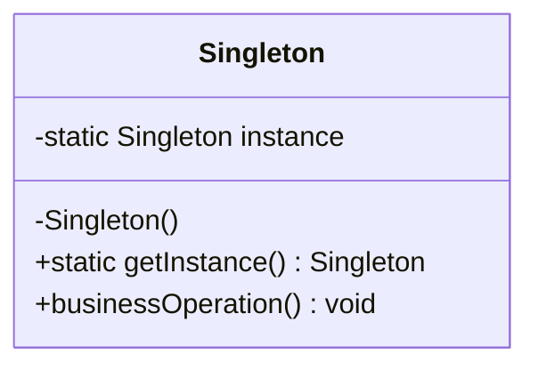
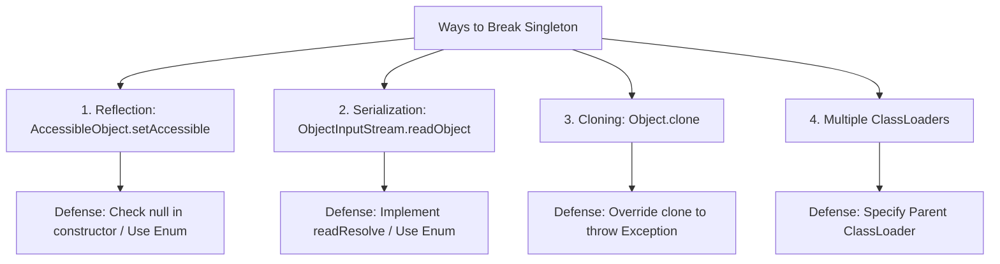
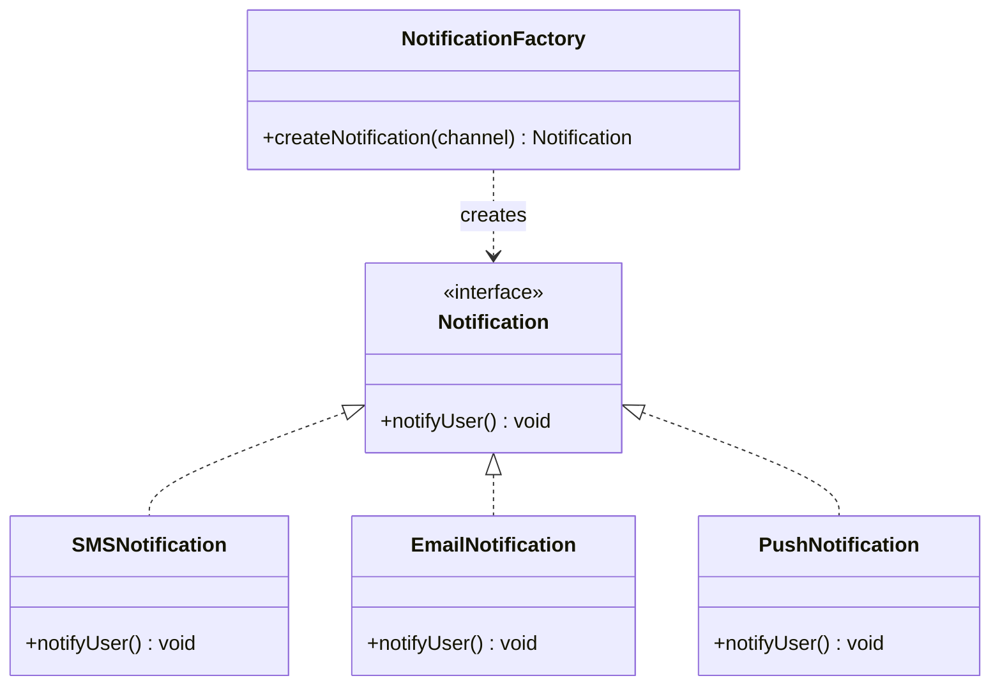
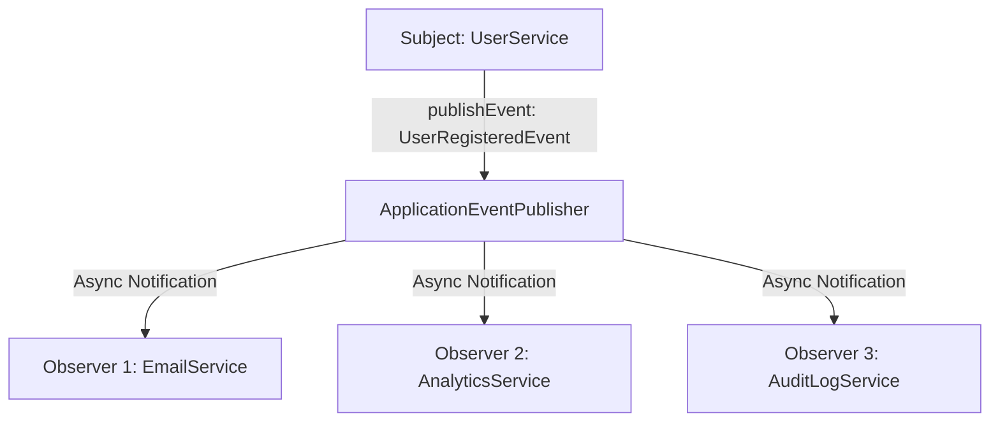

# Chapter 5: Creational & Structural Design Patterns

## Creational Design Patterns

### Singleton Pattern and Implementations

#### Definition and Purpose
The Singleton pattern ensures that a class has only one instance in memory within a given classloader, and provides a global, thread-safe access point to that instance. In enterprise systems, Singletons are utilized for stateful coordinators, hardware drivers, connection pools, and configuration registries where multiple instances would cause data corruption or resource exhaustion.



---

#### The Six Java Implementation Approaches

##### 1. Eager Initialization (Simple)
The instance is created at the time of class loading by the JVM.
```java
public class EagerSingleton {
    private static final EagerSingleton INSTANCE = new EagerSingleton();

    private EagerSingleton() {} // Private constructor prevents new instances

    public static EagerSingleton getInstance() {
        return INSTANCE;
    }
}
```
- **Evaluation:** Simple and inherently thread-safe because class initialization is guaranteed safe by the JVM class loader. However, the instance is allocated even if the application never uses it, which is inefficient for resource-heavy objects.

##### 2. Lazy Initialization (Not Thread-Safe)
Delays instance creation until `getInstance()` is called for the first time.
```java
public class LazySingleton {
    private static LazySingleton instance;

    private LazySingleton() {}

    public static LazySingleton getInstance() {
        if (instance == null) {
            instance = new LazySingleton(); // Race condition vulnerability!
        }
        return instance;
    }
}
```
- **Evaluation:** Memory-efficient, but strictly unsafe in multithreaded environments. If Thread A and Thread B reach `if (instance == null)` simultaneously, both will instantiate separate objects.

##### 3. Thread-Safe Synchronized Method
Guards the accessor method with standard Java synchronization.
```java
public class SynchronizedSingleton {
    private static SynchronizedSingleton instance;

    private SynchronizedSingleton() {}

    public static synchronized SynchronizedSingleton getInstance() {
        if (instance == null) {
            instance = new SynchronizedSingleton();
        }
        return instance;
    }
}
```
- **Evaluation:** Thread-safe, but introduces a massive performance bottleneck. Every subsequent read operation incurs synchronization lock acquisition overhead, degrading throughput up to 100x.

##### 4. Double-Checked Locking (High Performance)
Minimizes synchronization overhead by checking for null before and after entering a synchronized block.
```java
public class DoubleCheckedSingleton {
    // volatile is MANDATORY to prevent instruction reordering
    private static volatile DoubleCheckedSingleton instance;

    private DoubleCheckedSingleton() {}

    public static DoubleCheckedSingleton getInstance() {
        if (instance == null) { // First check (no locking)
            synchronized (DoubleCheckedSingleton.class) {
                if (instance == null) { // Second check (with locking)
                    instance = new DoubleCheckedSingleton();
                }
            }
        }
        return instance;
    }
}
```
- **The Critical Role of `volatile`:** During object creation (`new Singleton()`), the JVM executes three steps:
  1. Allocate memory.
  2. Initialize the constructor.
  3. Assign the memory address to the `instance` reference.
  Without `volatile`, the JVM compiler and CPU can reorder instructions (executing 1 $\rightarrow$ 3 $\rightarrow$ 2). Thread B could observe `instance != null` before constructor initialization completes, returning a partially initialized, corrupted object. `volatile` establishes a **happens-before** memory barrier that forbids instruction reordering.

##### 5. Bill Pugh Singleton (Initialization-on-Demand Holder Idiom)
Leverages the JVM's class-loading guarantees to achieve lazy loading without synchronization locks.
```java
public class BillPughSingleton {

    private BillPughSingleton() {}

    // Static nested class is not loaded until referenced
    private static class SingletonHolder {
        private static final BillPughSingleton INSTANCE = new BillPughSingleton();
    }

    public static BillPughSingleton getInstance() {
        return SingletonHolder.INSTANCE;
    }
}
```
- **Evaluation:** Best practice for class-based singletons. It is completely thread-safe, lazy-loaded, and avoids all synchronization overhead because the JVM guarantees that static inner classes are initialized atomically on first access.

##### 6. Enum Singleton (Joshua Bloch - Effective Java)
Represents the singleton instance as a single-element Java `enum`.
```java
public enum EnumSingleton {
    INSTANCE;

    public void executeBusinessLogic() {
        // Business logic here
    }
}
```
- **Evaluation:** The most robust singleton implementation in Java (recommended by Joshua Bloch). It provides built-in thread safety, automatic serialization guarantees, and immune defense against reflection attacks.

---

#### How to Break the Singleton Pattern and Defenses



1. **Reflection Attack:**
   - *How it breaks:* An attacker uses Java Reflection to bypass constructor visibility:
     ```java
     Constructor<Singleton> constructor = Singleton.class.getDeclaredConstructor();
     constructor.setAccessible(true);
     Singleton instance2 = constructor.newInstance();
     ```
   - *Defense:* Throw a runtime exception from inside the private constructor if an instance already exists, or use an `Enum` (the JVM forbids reflective instantiation of enums via `newInstance()`).
2. **Serialization Attack:**
   - *How it breaks:* Serializing a singleton to disk and deserializing it via `ObjectInputStream` creates a distinct second object in heap memory.
   - *Defense:* Implement the `readResolve()` hook:
     ```java
     protected Object readResolve() {
         return getInstance(); // Returns the existing canonical instance
     }
     ```
3. **Cloning Attack:**
   - *How it breaks:* If a singleton inherits from a class implementing `Cloneable`, calling `super.clone()` duplicates the instance.
   - *Defense:* Override `clone()` to throw `CloneNotSupportedException`:
     ```java
     @Override
     protected Object clone() throws CloneNotSupportedException {
         throw new CloneNotSupportedException("Singleton cloning forbidden");
     }
     ```
4. **Multiple ClassLoaders:**
   - *How it breaks:* If an enterprise application server loads the same singleton class through two different classloaders, each classloader will maintain its own static copy.
   - *Defense:* Ensure the singleton class is loaded strictly by a root or shared parent classloader.

---

### Factory Pattern and Decoupled Instantiation

#### Definition and Purpose
The Factory Method pattern defines an interface for creating objects, but defers the actual instantiation to factory classes or specialized factory methods. It adheres strictly to the Open/Closed Principle and Dependency Inversion Principle by decoupling client code from concrete implementation classes.



#### Production Java Implementation

```java
package com.enterprise.notification;

// 1. Common Product Interface
public interface Notification {
    void notifyUser(String recipient, String message);
}

// 2. Concrete Product Implementations
public class SMSNotification implements Notification {
    @Override
    public void notifyUser(String recipient, String message) {
        // Dispatches via Twilio / Telco Gateway
    }
}

public class EmailNotification implements Notification {
    @Override
    public void notifyUser(String recipient, String message) {
        // Dispatches via SMTP / SendGrid
    }
}

public class PushNotification implements Notification {
    @Override
    public void notifyUser(String recipient, String message) {
        // Dispatches via Apple APNs / Google FCM
    }
}

// 3. The Factory
public class NotificationFactory {
    public static Notification createNotification(String channel) {
        if (channel == null || channel.isEmpty()) {
            throw new IllegalArgumentException("Channel cannot be null or empty");
        }
        switch (channel.toUpperCase()) {
            case "SMS":
                return new SMSNotification();
            case "EMAIL":
                return new EmailNotification();
            case "PUSH":
                return new PushNotification();
            default:
                throw new IllegalArgumentException("Unknown notification channel: " + channel);
        }
    }
}

// 4. Decoupled Client Usage
public class AlertService {
    public void sendAlert(String channel, String recipient, String message) {
        // Client depends strictly on the Notification interface abstraction
        Notification notification = NotificationFactory.createNotification(channel);
        notification.notifyUser(recipient, message);
    }
}
```

#### Architectural Value in Enterprise Systems
- **Centralized Instantiation Logic:** If instantiating a product requires configuring credentials, connection timeouts, or encryption keys, that logic resides exclusively inside the factory rather than being scattered across 50 client classes.
- **Dynamic Swapping:** The client code is completely isolated from object lifecycles. Adding a new notification medium (e.g., WhatsApp) requires creating `WhatsAppNotification` and updating the factory; all calling services remain completely untouched.

---

## Structural and Behavioral Design Patterns

### Adapter Pattern and Anti-Corruption Layer

#### 1. The Core Problem: Incompatible Interfaces & Domain Pollution
When building modern enterprise systems, teams frequently integrate legacy systems (e.g., 15-year-old SOAP/XML services) or third-party vendor SDKs (e.g., Stripe, PayPal, Salesforce).
- **The Threat:** The vendor's API models, data types, and proprietary exceptions bleed into your application's core domain models. If the vendor updates their SDK or the organization switches payment providers, changes ripple through every business service, violating clean architecture.

#### 2. The Mechanics: The Translation Bridge
The **Adapter Pattern** allows two incompatible interfaces to collaborate by converting the interface of a class into another interface that clients expect.

```mermaid
flowchart LR
    Client[Application Client] -->|Calls Standard Domain Interface| Target[Target: PaymentProcessor]
    Target <|.. Adapter[Adapter: StripeAdapter]
    Adapter -->|"Translates & Wraps"| Adaptee[Adaptee: StripeService Vendor SDK]
```

- **Target Interface:** The clean domain contract expected by your application (`PaymentProcessor`).
- **Adaptee:** The external, incompatible third-party class (`StripeService`).
- **Adapter:** The bridge class that implements the Target Interface, wraps the Adaptee, translates data formats, maps exceptions, and delegates calls.

#### 3. Production Java Implementation

```java
package com.enterprise.payment.adapter;

// 1. Target Interface: Clean Domain Model
public interface PaymentProcessor {
    void processPayment(String dollarAmount);
}

// 2. Adaptee: Incompatible Vendor SDK (expects cents as double)
public class StripeService {
    public void makePayment(double cents) {
        System.out.println("Stripe processing charge of " + cents + " cents.");
    }
}

// 3. The Adapter: The Translation Bridge
public class StripeAdapter implements PaymentProcessor {

    private final StripeService stripeService;

    // Inject the incompatible adaptee
    public StripeAdapter(StripeService stripeService) {
        this.stripeService = stripeService;
    }

    @Override
    public void processPayment(String dollarAmount) {
        // Translate domain data (Dollars as String) to vendor data (Cents as double)
        double cents = Double.parseDouble(dollarAmount) * 100.0;
        
        // Delegate execution to the vendor service
        stripeService.makePayment(cents);
    }
}

// 4. Client Usage in Core Application
public class CheckoutService {
    private final PaymentProcessor paymentProcessor;

    public CheckoutService(PaymentProcessor paymentProcessor) {
        this.paymentProcessor = paymentProcessor;
    }

    public void checkout() {
        // Client interacts exclusively with the clean domain interface
        paymentProcessor.processPayment("49.99");
    }
}
```

#### 4. The Architect's Perspective: The Anti-Corruption Layer (ACL)
In Domain-Driven Design (DDD), an **Anti-Corruption Layer (ACL)** is an architectural elevation of the Adapter pattern:
- When integrating with legacy systems, the Adapter isolates the "mess."
- The Adapter takes pristine internal Domain Objects, translates them into the verbose XML/JSON required by the legacy vendor, makes the network call, catches proprietary vendor exceptions, and maps the response back into clean domain entities.
- The external vendor's data structures are physically quarantined at the adapter boundary, ensuring they never contaminate internal core business logic.

#### 5. Real-World Java Standard Library Examples
- `java.util.Arrays.asList(T... a)`: Adapts a raw Java array into the standard `List` Collection interface.
- **SLF4J (Simple Logging Facade for Java):** The entire SLF4J library acts as a set of adapters, allowing applications to compile against a single unified logging interface (`Logger`) while adapting to different underlying logging implementations (Logback, Log4j2) at runtime.

---

### Observer Pattern and Event-Driven Decoupling

#### 1. The Core Problem: Tight Coupling & The "God Service"
In monolithic architectures, services become tightly coupled through sequential method calls. For example, when a new user registers:
- `UserService` persists the user to the database.
- `UserService` explicitly calls `EmailService.sendWelcomeEmail()`.
- `UserService` explicitly calls `AnalyticsService.logRegistrationMetric()`.
- `UserService` explicitly calls `BillingService.createStripeCustomer()`.

**The Threat:** This violates the Single Responsibility Principle. `UserService` becomes a massive orchestrator. If the external email server is down, user registration fails. Furthermore, adding new post-registration behaviors requires modifying and redeploying core `UserService` code.

#### 2. The Mechanics: Push vs. Pull (The YouTube Subscription Analogy)
The **Observer Pattern** shifts the architecture from imperative commands to event-driven reactive notifications:
- Think of a YouTube channel subscription. Rather than viewers constantly polling the channel every 5 minutes to see if a video was uploaded (Pulling), viewers click "Subscribe." The channel maintains a subscriber list. When a video is published, the channel pushes notifications to all registered observers automatically.
- **Subject (Publisher):** Maintains a collection of observers and notifies them when its internal state changes.
- **Observer (Subscriber):** Implements an update interface and registers with the Subject to receive push notifications.



#### 3. Production Implementation with Spring Boot `@EventListener`
In modern enterprise Spring applications, developers leverage Spring's native `ApplicationEventPublisher` to mediate observer relationships without maintaining manual subscriber lists:

```java
package com.enterprise.user.service;

import org.springframework.context.ApplicationEventPublisher;
import org.springframework.stereotype.Service;
import org.springframework.transaction.annotation.Transactional;

// 1. The Event (Immutable State Change DTO)
public record UserRegisteredEvent(String userId, String email) {}

// 2. The Subject (Publisher)
@Service
public class UserService {

    private final UserRepository userRepository;
    private final ApplicationEventPublisher eventPublisher;

    public UserService(UserRepository userRepository, ApplicationEventPublisher eventPublisher) {
        this.userRepository = userRepository;
        this.eventPublisher = eventPublisher;
    }

    @Transactional
    public void registerUser(UserRegistrationDto dto) {
        User user = userRepository.save(new User(dto));
        
        // Fire-and-forget event broadcast.
        // UserService has ZERO knowledge of emails, analytics, or billing.
        eventPublisher.publishEvent(new UserRegisteredEvent(user.getId(), user.getEmail()));
    }
}

// 3. The Observers (Listeners)
@Service
public class WelcomeEmailListener {

    @org.springframework.scheduling.annotation.Async // Executes in background thread pool
    @org.springframework.context.event.EventListener
    public void onUserRegistered(UserRegisteredEvent event) {
        // Dispatches welcome email asynchronously without blocking registration
        System.out.println("Sending welcome email to: " + event.email());
    }
}

@Service
public class AnalyticsListener {

    @org.springframework.scheduling.annotation.Async
    @org.springframework.context.event.EventListener
    public void onUserRegistered(UserRegisteredEvent event) {
        // Records registration event in real-time analytics engine
        System.out.println("Logging metric for user: " + event.userId());
    }
}
```

#### 4. The Architect's Perspective: Distributed Observers
When an application scales beyond a single JVM into distributed microservices, Spring's in-memory `@EventListener` cannot cross network boundaries. The Observer pattern is elevated to the infrastructure level:
- **Message Brokers (Apache Kafka / RabbitMQ):** In a microservices architecture, a Kafka Topic acts as the distributed **Subject**, and independent microservices act as distributed **Observers** (consumer groups) that react to state changes at their own pace.
- **Reactive Streams (Project Reactor / Spring WebFlux):** Project Reactor's `Flux` and `Mono` are reactive implementations of the Observer pattern. Reactive publishers emit data streams over time, while subscriber pipelines observe and process emitted events asynchronously.
