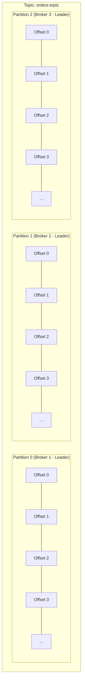
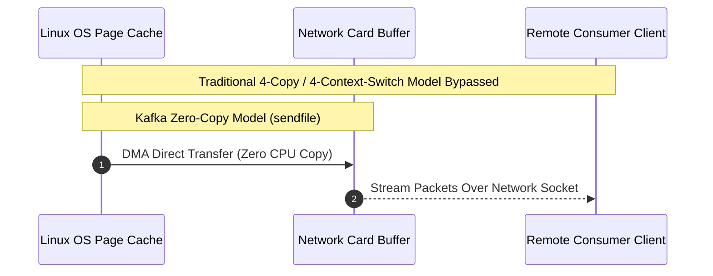

# Apache Kafka & Event-Driven Architecture

## Event-Driven Architecture and Messaging Fundamentals

### Point-to-Point Architecture vs Distributed Event Streaming

#### The Core Problem: The Point-to-Point Spaghetti Mesh
In traditional microservice architectures, services communicate via direct, synchronous HTTP/REST or RPC calls. When an event occurs (e.g., an `OrderCreated` event), the `OrderService` must explicitly know about and call every downstream system that requires this information: `PaymentService`, `InventoryService`, `NotificationService`, `AnalyticsService`, and `BillingService`.

This model suffers from critical architectural vulnerabilities:
- **Cascading Latency Bottlenecks**: The total response latency is bound to the slowest downstream service. If `AnalyticsService` experiences high latency, `OrderService` threads hang waiting for HTTP responses, exhausting thread pools and degrading end-user experience.
- **Unrecoverable Data Loss**: If `BillingService` or `InventoryService` crashes during an HTTP request, the order payload is permanently lost unless complex, failure-prone distributed retry queues are manually implemented.
- **Tight Temporal and Structural Coupling**: The upstream service must know the network location, API contract, and health state of every downstream consumer. Adding a new consumer requires modifying, retesting, and redeploying the upstream producer.

```mermaid
flowchart LR
    subgraph Synchronous_Spaghetti["Point-to-Point Synchronous HTTP (Brittle)"]
        OS1["Order Service"] -->|HTTP POST| PS1["Payment Service"]
        OS1 -->|HTTP POST| IS1["Inventory Service"]
        OS1 -->|HTTP POST| NS1["Notification Service"]
        OS1 -->|HTTP POST (Slow)| AS1["Analytics Service (Bottleneck)"]
        OS1 -->|HTTP POST (Down)| BS1["Billing Service (Data Loss!)"]
    end

    subgraph Event_Driven["Kafka Distributed Event Stream (Decoupled)"]
        OS2["Order Service"] -->|Publish Event| KT["Kafka: orders-topic"]
        KT -->|Pull Batch| PS2["Payment Service"]
        KT -->|Pull Batch| IS2["Inventory Service"]
        KT -->|Pull Batch| NS2["Notification Service"]
        KT -->|Pull at Own Pace| AS2["Analytics Service"]
        KT -->|Resume from Offset| BS2["Billing Service"]
    end
```

#### The Event-Driven Solution
Apache Kafka introduces an asynchronous, publish-subscribe paradigm backed by a durable commit log.
- Producers stop asking *"Who do I send this to?"* and instead declare: *"An event occurred; here is the immutable fact. Anyone who cares may consume it."*
- Decouples producers and consumers temporally, geographically, and logically.
- Downstream services can go offline, reboot, or lag behind during traffic spikes without affecting upstream producer latency or losing a single byte of data.

---

## Core Architecture and Storage Engine

### Distributed Commit Log Architecture: Topics and Partitions

#### Definition
Unlike traditional message brokers (such as RabbitMQ or IBM MQ) that delete messages once acknowledged by a consumer, **Apache Kafka is a distributed, append-only, partitioned commit log**. Messages are written sequentially to disk and retained immutably for a configurable retention window, regardless of whether they have been consumed.

#### Topics, Partitions, and Horizontal Scale
- **Topic**: A logical category or stream name to which records are published (e.g., `customer-transactions`, `order-events`).
- **Partitions (The Secret to Horizontal Scale)**:
  - A single topic is divided into one or more **Partitions**.
  - A partition is an ordered, immutable sequence of records continuously appended to a structured commit log file on disk.
  - Partitions allow a single topic to be distributed across multiple independent servers (Brokers).
  - Partitions are the fundamental unit of parallelism and horizontal scalability in Kafka: throughput scales linearly with the number of partitions.



---

### Offsets and Consumer Bookmarking

#### Definition
An **Offset** is a 64-bit monotonically increasing integer assigned sequentially to each message within a partition upon arrival. It acts as the immutable physical bookmark identifying a record's precise position within that partition.

#### Consumer Bookmarking Mechanics
- Offsets are local to a specific partition; Partition 0, Offset 10 has no relation to Partition 1, Offset 10.
- Consumers maintain their read position by committing their current offset back to an internal, highly compacted Kafka topic named `__consumer_offsets`.
- **Fault Recovery**: If a consumer instance crashes while processing Offset 450, a replacement consumer assigned that partition reads the committed offset from `__consumer_offsets` and immediately resumes processing from Offset 451 with zero data duplication.
- **Consumer Lag**: The difference between the highest offset written by producers (Log End Offset - LEO) and the current offset processed by a consumer group (Current Offset). High consumer lag indicates downstream processing saturation.

---

### High-Throughput Engine: Sequential IO, Page Cache, and Zero-Copy

#### Why Kafka Outperforms Traditional Databases and Message Brokers
Interviewers frequently ask why Kafka can process millions of messages per second on modest hardware while traditional relational databases struggle. Kafka's extreme throughput is driven by three architectural principles:

#### 1. Sequential Disk I/O vs Random Disk I/O
- Traditional relational databases perform random disk I/O to maintain B-Trees, table heaps, and index updates, which forces physical disk heads to seek across spinning platters or SSD NAND blocks.
- Kafka strictly appends records to the end of a 64-bit log segment file (**Sequential I/O**).
- Linear sequential disk writes bypass disk seek overhead entirely. On modern enterprise SSDs and HDDs, sequential write performance reaches 600–1000 MB/sec, approaching the theoretical speed of writing directly to RAM.

#### 2. Linux OS Page Cache Utilization
- Instead of maintaining complex caching layers inside JVM heap memory (which would trigger severe Garbage Collection pauses and object serialization overhead), Kafka relies directly on the **Linux OS Page Cache**.
- All unallocated host RAM is automatically utilized by the Linux kernel as an OS-level file cache.
- When producers write to Kafka, data is written to the Page Cache first and flushed to disk asynchronously by OS kernel threads (`pdflush`/`flush`).

#### 3. Zero-Copy Data Transfer via `sendfile()` System Call
- In traditional network socket transfers, data undergoes 4 context switches and 4 memory copies between user space and kernel space:
  1. Disk to OS Page Cache (Kernel space via DMA).
  2. OS Page Cache to JVM User Space Buffer (CPU copy).
  3. JVM Buffer to Socket Buffer in Kernel space (CPU copy).
  4. Socket Buffer to Network Interface Controller (NIC) buffer (Kernel space via DMA).
- **Kafka Zero-Copy**: Kafka uses the Linux `sendfile()` system call (Java `FileChannel.transferTo()`).
  - Data is read directly from the OS Page Cache into the NIC network buffer via DMA (Direct Memory Access).
  - Data **never** enters JVM user space, eliminating CPU data copying and context switches entirely, resulting in near-zero CPU overhead during message consumption.



#### 4. Pull vs Push Model
- **Push Architecture (e.g., RabbitMQ)**: The broker pushes messages to consumers. If traffic surges, slow consumers become overwhelmed, exhausting memory buffers and crashing.
- **Pull Architecture (Kafka)**: Consumers continuously poll Kafka brokers (`poll(Duration)`) requesting batches of records at their own processing capacity. If a consumer falls behind, it simply accumulates consumer lag without crashing.

---

## Producers, Consumers, and Stream Mechanics

### Producers and Partitioning Strategies

#### Producer Mechanics
Producers serialize domain objects, assign target partitions, batch records in memory buffers (`RecordAccumulator`), and send batches asynchronously over TCP connections.

#### Partitioning Strategies
1. **Keyed Messages (Murmur2 Hash)**:
   - When a record specifies a `key` (e.g., `userId`, `orderId`), Kafka calculates:
     $$\text{Target Partition} = \text{abs}(\text{MurmurHash2}(\text{key})) \pmod{\text{Total Number of Partitions}}$$
   - **Crucial Guarantee**: All messages sharing the exact same key are guaranteed to land on the **same partition**, ensuring **strict chronological ordering** per entity key.
2. **Keyless Messages (Sticky Partitioner)**:
   - When the `key` is `null`, modern Kafka clients (2.4+) use the **Sticky Partitioner**. It fills a single partition's batch buffer before switching to the next partition, maximizing compression efficiency and minimizing network roundtrips (superseding old round-robin).
3. **Custom Partitioner**: Custom Java classes implementing `org.apache.kafka.clients.producer.Partitioner` to enforce domain-specific partitioning logic (e.g., routing VIP enterprise accounts to dedicated partitions).

---

### Consumer Groups and Partition Rebalancing

#### Consumer Group Model
A **Consumer Group** is a set of consumer instances that cooperate to consume data from one or more topics. Each consumer in the group runs as an independent process/pod.

#### The Fundamental Cardinality Rules
1. **One-to-One Ownership**: Each partition in a topic is assigned to **exactly one** consumer instance within a specific consumer group.
2. **Parallelism Ceiling**: The maximum parallel processing capacity of a consumer group equals the number of partitions in the topic.
   - *Example*: If a topic has 10 partitions:
     - 5 consumers in Group A $\rightarrow$ Each consumer handles 2 partitions.
     - 10 consumers in Group A $\rightarrow$ Each consumer handles 1 partition (ideal 1:1 parity).
     - 15 consumers in Group A $\rightarrow$ 10 consumers handle 1 partition each; 5 consumers sit completely idle as warm backups.
3. **Multiple Groups**: Different consumer groups read independently and simultaneously from the same topic without interfering with each other's offsets.

#### Partition Rebalancing
A **Rebalance** is the redistribution of partition assignments across consumers within a group.
- **Triggers**:
  - A new consumer joins the group (e.g., autoscaling).
  - An existing consumer crashes, disconnects, or fails heartbeats (`session.timeout.ms`).
  - A consumer takes too long processing a batch, exceeding `max.poll.interval.ms`.
  - New partitions are added to the topic.
- **Rebalance Protocols**:
  - **Eager Rebalance (Stop-the-World)**: All consumers revoke their partition assignments, pause consumption, rejoin the group, and receive new assignments. Causes severe latency spikes.
  - **Cooperative Sticky Rebalance (Incremental)**: Consumers continue reading from unaffected partitions; only partitions migrating between members are temporarily paused and reassigned, eliminating global stop-the-world pauses.

---

## Reliability and Fault Tolerance

### Zero Data Loss Guarantees and Durability Configurations

#### Achieving Zero Data Loss (The Golden Triangle)
To guarantee 100% zero data loss during broker crashes, network splits, and hardware failures, three configuration parameters across producers and brokers must be aligned:

1. **Producer `acks=all` (or `acks=-1`)**:
   - The producer client will not consider a message successfully sent until the leader broker AND all In-Sync Replicas (ISR) have written the record to their local commit logs.
2. **Topic `replication.factor >= 3`**:
   - Every partition is replicated across at least 3 distinct brokers located in separate availability zones.
3. **Topic/Broker `min.insync.replicas >= 2`**:
   - Specifies the minimum number of replicas in the ISR that must acknowledge a write for `acks=all` to succeed. If the active ISR count falls below `min.insync.replicas`, the broker rejects writes with `NotEnoughReplicasException`, preventing un-replicated writes.
4. **Broker `unclean.leader.election.enable = false`**:
   - Never allow an out-of-sync replica (outside the ISR) to become the partition leader if the current leader crashes. Choosing data consistency over temporary topic unavailability.

```
+-------------------------------------------------------------------------------+
|                       ZERO DATA LOSS TRIANGLE MATRIX                         |
|                                                                               |
|   Producer Configuration:                                                     |
|       acks = all (-1)                                                         |
|       retries = Integer.MAX_VALUE                                             |
|       max.in.flight.requests.per.connection <= 5                              |
|                                                                               |
|   Broker / Topic Configuration:                                               |
|       replication.factor = 3                                                  |
|       min.insync.replicas = 2                                                 |
|       unclean.leader.election.enable = false                                  |
+-------------------------------------------------------------------------------+
```

---

### Exactly-Once Semantics: Idempotence and Transactions

#### 1. Idempotent Producer (`enable.idempotence=true`)
- Solves duplicate messages caused by transient network failures.
- If a broker writes a record and commits it to disk, but the network connection drops before sending the ACK back to the producer, the producer will automatically retry.
- In standard producers, this creates duplicate records in the partition.
- **Internal Mechanics**:
  - The broker assigns each producer a unique 64-bit Producer ID (PID) via `InitProducerId`.
  - The producer attaches a monotonically increasing sequence number (starting at 0) to every message per partition.
  - The broker verifies incoming sequence numbers: if a record arrives with a sequence number $\le$ the last committed sequence number for that PID, the broker acknowledges it but discards the duplicate payload.
- Zero performance overhead; enabled by default in Kafka 3.0+.

#### 2. Kafka Transactions (`Transactional Producer & Consumer`)
- Guarantees **Atomic Multi-Partition Writes**: Either all messages across multiple distinct topics and partitions are written, or none are.
- Essential for the **Consume-Transform-Produce** pattern (reading from Topic A, updating state, publishing to Topic B, and committing the consumer offset to `__consumer_offsets` in a single atomic transaction).
- Coordinates via an internal **Transaction Coordinator** broker using a two-phase commit protocol and marker records.
- Downstream consumers configure `isolation.level = read_committed`, filtering out uncommitted or aborted transaction messages.

---

## Storage Compaction, Streaming, and Metadata

### Log Retention and Log Compaction

#### Log Retention Strategies
Kafka partitions are physically stored on disk as a directory of segment files (default 1 GB per segment).
- **Time-Based Retention**: `log.retention.hours = 168` (retains records for 7 days, after which segments are deleted).
- **Size-Based Retention**: `log.retention.bytes` (deletes oldest segments when partition exceeds threshold).

#### Log Compaction (`log.cleanup.policy=compact`)
- Instead of deleting records based purely on age, **Log Compaction** guarantees that Kafka retains at least the **most recent value for each message key** within the log.
- **Use Cases**: Restoring application state caches, maintaining materialized views, database change data capture (CDC via Debezium).
- **Tombstone Records**: To delete a key permanently in a compacted topic, a producer writes a record with that key and a `null` payload. The cleaner thread retains the tombstone for a grace period (`delete.retention.ms`) before purging it from disk.

---

### Real-Time Stream Processing and Kafka Streams API

#### Definition
Kafka Streams is a lightweight, client-side Java library for building real-time stream processing applications that read from Kafka topics, transform data, and write back to Kafka topics without requiring external processing clusters (unlike Apache Spark or Apache Flink).

#### Core Concepts
- **KStream vs KTable Duality**:
  - **`KStream` (Fact Stream)**: Represents an append-only stream of independent events (e.g., `PaymentReceived`, `PageClicked`). Every record is an insert.
  - **`KTable` (Changelog / Materialized View)**: Represents the current state at any given point in time. Incoming records act as upserts based on key.
  - **`GlobalKTable`**: Fully replicated cache of an entire topic populated on every instance, used for star-schema lookups.
- **Stateful Processing with RocksDB**:
  - Stateful aggregations (e.g., `count()`, `reduce()`, windowed joins) store intermediate state locally inside an embedded, ultra-fast C++ **RocksDB** key-value store on the local pod disk.
  - Fault tolerance: All RocksDB mutations are backed by an internal Kafka changelog topic. If a pod crashes and restarts elsewhere, it reconstructs its RocksDB state by replaying the changelog.
- **Windowing Strategies**:
  - **Tumbling Window**: Fixed-size, non-overlapping time windows (e.g., transactions per 5-minute block: 00:00-00:05, 00:05-00:10).
  - **Hopping Window**: Fixed-size, overlapping time windows (e.g., 5-minute window advancing every 1 minute).
  - **Sliding Window**: Evaluates records based on time delta between events (e.g., joins within 10 seconds of each other).
  - **Session Window**: Groups events based on inactivity periods (e.g., user browsing activity until 30 minutes of idle time).

---

### Metadata Management: ZooKeeper vs KRaft Mode

#### The Role of Legacy Apache ZooKeeper
Historically, Kafka relied on Apache ZooKeeper as an external distributed coordination engine to:
1. Maintain cluster membership and broker registration.
2. Coordinate partition leader election and In-Sync Replica (ISR) tracking.
3. Elect the active Kafka Controller broker.
4. Store topic configurations and security ACLs.

#### The KRaft Revolution (Kafka Raft Metadata Mode - KIP-500)
Starting in Kafka 2.8 (production-ready in 3.3+ and ZooKeeper fully removed in Kafka 4.0), Kafka replaced ZooKeeper with **KRaft**, an internal Raft consensus protocol.

| Dimension | Legacy ZooKeeper Mode | Modern KRaft Mode |
| :--- | :--- | :--- |
| **Architecture** | External cluster of ZooKeeper nodes + separate Kafka cluster. | Single unified Kafka system running Controller Quorum nodes. |
| **Partition Scalability** | Max ~200,000 partitions cluster-wide before ZooKeeper memory saturation. | Scales to **millions of partitions** per cluster. |
| **Controller Failover** | Slow (seconds to minutes) as new controller loaded all metadata from ZooKeeper. | **Sub-second instantaneous failover**; controllers maintain hot in-memory state. |
| **Metadata Consistency** | Risk of metadata desynchronization between ZooKeeper and Kafka controllers. | Event-driven `@metadata` topic replicated via Raft consensus. |
| **Operational Overhead** | Managing two separate distributed systems, two security models, two JVM runtimes. | Single binary, single security model, streamlined monitoring. |

---

## Best Practices and Anti-Patterns

### Production Best Practices
1. **Always Set Message Keys for Dependent State**: Always supply an explicit entity key (`orderId`, `customerId`) when ordering matters.
2. **Implement Dead Letter Queues (DLQ)**: Never drop unparseable poisoned pills; route failed records to an error topic with failure metadata headers.
3. **Tune Batching for High Throughput**: Configure producer `linger.ms=20` and `compression.type=lz4` or `zstd` to allow records to coalesce into dense, compressed batches before network transmission.
4. **Monitor Consumer Group Lag Continuously**: Track consumer lag metrics via Prometheus and Burrow to autoscale consumers before lag threatens SLAs.

### Common Pitfalls
1. **Over-Partitioning Beyond Sizing Needs**: Creating 10,000 partitions on small clusters causes memory pressure, file descriptor exhaustion, and longer rebalance times.
2. **Blocking the Consumer Poll Loop**: Performing long-running synchronous database writes inside the Kafka consumer loop that exceed `max.poll.interval.ms`, causing Kafka to assume the consumer died and triggering an endless cascade of rebalances.
3. **Relying on Default Producer Settings**: Default producer `acks=1` can cause silent data loss if the leader broker crashes before replicating to followers.

---

## Official References
- Apache Kafka Official Documentation: [Kafka Design & Architecture](https://kafka.apache.org/documentation/#design)
- KIP-500: [Replace ZooKeeper with a Self-Managed Metadata Quorum (KRaft)](https://cwiki.apache.org/confluence/display/KAFKA/KIP-500%3A+Replace+ZooKeeper+with+a+Self-Managed+Metadata+Quorum)
- Confluent Architecture Guides: [Kafka Storage Internals & Zero Data Loss](https://developer.confluent.io/courses/architecture/storage/)
- Kafka Streams Architecture: [Kafka Streams Developer Guide](https://kafka.apache.org/documentation/streams/developer-guide/)
