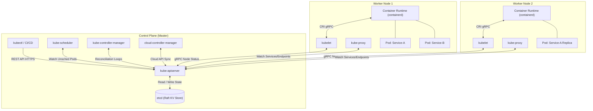

# Kubernetes Container Orchestration

## Kubernetes Cluster Architecture

### Control Plane Components

#### Definition
The Kubernetes Control Plane (traditionally called the Master node) is the central administrative brain of the cluster. It makes global decisions about the cluster (e.g., scheduling workloads), detects and responds to cluster events (e.g., restarting a crashed pod), and manages cluster state.

#### Core Components and Internal Mechanics
- **`kube-apiserver`**:
  - The front door of the Kubernetes control plane. It exposes the Kubernetes REST API (JSON over HTTP/gRPC).
  - It is the **only** component in the entire cluster that communicates directly with `etcd`. All other control plane components, worker node daemons (`kubelet`), and administrative CLI tools (`kubectl`) interact strictly through the `kube-apiserver`.
  - It handles authentication, authorization (RBAC), admission controllers (e.g., validating and mutating webhooks), and schema validation.
  - Horizontally scalable: multiple instances can run behind an external Layer 4/Layer 7 load balancer.
- **`etcd`**:
  - A strongly consistent, highly available, distributed key-value store implementing the Raft consensus algorithm.
  - Serves as the ultimate source of truth and persistent state store for all cluster specifications and runtime statuses.
  - Modifying cluster state is performed strictly via atomic compare-and-swap operations mediated by the `kube-apiserver`.
  - High availability production topologies require an odd number of members (typically 3 or 5) to survive network partitions and prevent split-brain conditions.
- **`kube-scheduler`**:
  - The control plane component that watches for newly created Pods with no assigned node (`spec.nodeName` is empty) and assigns them to a healthy, optimal worker node.
  - Execution pipeline:
    1. **Filtering (Predicates)**: Eliminates nodes that cannot run the Pod (e.g., insufficient CPU/Memory, node taints without matching tolerations, port conflicts, node selector mismatches).
    2. **Scoring (Priorities)**: Ranks surviving candidate nodes based on configured scoring rules (e.g., spreading pods across nodes/availability zones, resource utilization efficiency, image locality).
    3. **Binding**: Sends a binding request to the `kube-apiserver` to write the chosen `nodeName` into the Pod object in `etcd`.
- **`kube-controller-manager`**:
  - A single daemon process that embeds core control loop controllers.
  - Each controller continuously compares the **current state** of the cluster with the **desired state** (declared in `etcd`) and executes reconciliation loops (`Reconcile()`):
    - *Node Controller*: Detects and responds when nodes go offline.
    - *ReplicaSet Controller*: Ensures the exact requested number of pod replicas are running.
    - *Endpoints Controller*: Populates EndpointSlice objects linking Services to Pod IPs.
    - *ServiceAccount & Token Controllers*: Creates default accounts and API access tokens for new namespaces.
- **`cloud-controller-manager`**:
  - Decouples cloud-provider-specific logic from the core Kubernetes binaries.
  - Interacts with underlying cloud provider APIs (AWS, GCP, Azure) to manage resources:
    - *Node Controller*: Verifies if a stopped node in K8s has been terminated in the cloud provider.
    - *Route Controller*: Configures routing tables in cloud provider VPCs.
    - *Service Controller*: Creates, configures, and decommissions native cloud load balancers (e.g., AWS NLB/ALB, GCP Cloud Load Balancing) when a Service of type `LoadBalancer` is created.



---

### Worker Node Components

#### Definition
Worker Nodes are the physical servers or virtual machines that execute the actual application workloads encapsulated in containerized Pods.

#### Core Daemons and Responsibilities
- **`kubelet`**:
  - The primary node agent running on every worker node.
  - Receives `PodSpecs` (primarily from the `kube-apiserver` or local static pod manifests) and ensures that the containers described in those manifests are running, healthy, and crash-loop managed.
  - Interacts with container runtimes via the Container Runtime Interface (CRI) gRPC protocol.
  - Executes container health checks (Liveness, Readiness, Startup probes).
  - Collects node and pod resource metrics and reports node heartbeat and status back to the `kube-apiserver`.
- **`kube-proxy`**:
  - The network proxy running on each node that implements the Kubernetes Service abstraction.
  - Watches the `kube-apiserver` for changes in Service and EndpointSlice objects.
  - Programs host networking packet-filtering engines (principally Linux `iptables` or `IPVS` - IP Virtual Server) to translate virtual Service ClusterIPs and ports to target Pod private IPs.
  - Provides rudimentary Layer 4 connection routing and round-robin / random load balancing across healthy pods.
- **Container Runtime**:
  - The underlying software engine executing container lifecycles (downloading images, creating namespaces, cgroups, starting/stopping root filesystems).
  - Complies with Open Container Initiative (OCI) runtime standards via CRI.
  - Modern production standards: `containerd` and `CRI-O` (Docker engine was deprecated in Kubernetes v1.20 and removed in v1.24 via Dockershim removal).

---

### Pods and Multi-Container Patterns

#### Definition
A **Pod** is the smallest deployable and manageable computing unit in Kubernetes. A Pod encapsulates one or more Linux containers, shared storage volumes, a unique cluster-wide network IP address, and runtime options.

#### Pod Architectural Characteristics
1. **Shared Network Namespace**: All containers in a single Pod share the same network namespace (same IP address, port space, and localhost loopback adapter). Container A can communicate with Container B over `localhost:<port>`.
2. **Shared Storage Volumes**: Pod-level volumes can be mounted into identical or distinct directory paths across multiple containers within the same Pod.
3. **Fate Sharing**: All containers within a Pod are scheduled onto the same physical/virtual node, started, stopped, and scaled together.

#### Multi-Container Design Patterns
- **Sidecar Pattern**: Enhances or extends the primary container without changing primary application code (e.g., Envoy proxy sidecar in Istio service mesh, logging agent like Fluentbit/Promtail shipping local log files).
- **Ambassador Pattern**: Proxies network connections from the main container to external systems (e.g., local database proxy routing read requests to read replicas and write requests to master).
- **Adapter Pattern**: Standardizes output or monitoring metrics from the application container to adhere to corporate or cluster monitoring standards (e.g., exposing Prometheus format `/metrics` from a legacy proprietary stats format).
- **Init Containers**: Specialized containers that run to completion sequentially before application containers start (e.g., waiting for database schema migrations to complete, configuring iptables rules).

---

## Microservice Deployment Lifecycle

### Microservice Deployment Pipeline

#### Overview
Deploying a microservice to Kubernetes transforms application code into a scalable, running, resilient set of containers managed declaratively by the control plane.

#### Standard 5-Step Pipeline
1. **Containerize the Microservice**:
   - Write a multi-stage `Dockerfile` packaging the compiled artifact (e.g., Spring Boot executable JAR), minimal operating system, and runtime dependencies.
   - Employ minimal base images (e.g., `distroless` or `alpine`) and non-root security contexts.
2. **Build and Push to Container Registry**:
   - Build immutable image tags (using semantic versioning or Git commit SHAs, never relying on `:latest` in production) and push to Docker Hub, AWS ECR, GCP Artifact Registry, or Azure ACR.
3. **Author Declarative Manifests**:
   - Define Kubernetes objects in declarative YAML: `Deployment` (state, replicas, rollout strategy, container spec), `Service` (internal stable networking), `ConfigMap`/`Secret` (externalized environment configurations).
4. **Apply Configuration via kubectl**:
   - Submit manifests using `kubectl apply -f manifest.yaml`.
   - The `kube-apiserver` validates schemas, stores records in `etcd`, `kube-scheduler` assigns nodes, and node `kubelet` daemons pull images and start containers.
5. **Expose to External Traffic**:
   - Route ingress HTTP/S traffic through an Ingress resource or cloud-provisioned Layer 4/Layer 7 Load Balancer.

#### Dockerfile Example
```dockerfile
# Multi-stage build for Spring Boot microservice
FROM eclipse-temurin:17-jdk-jammy AS builder
WORKDIR /workspace
COPY pom.xml mvnw ./
COPY .mvn .mvn
RUN ./mvnw dependency:go-offline
COPY src src
RUN ./mvnw clean package -DskipTests

# Minimal secure runtime image
FROM eclipse-temurin:17-jre-jammy
WORKDIR /app
RUN addgroup --system appgroup && adduser --system --ingroup appgroup appuser
USER appuser
COPY --from=builder /workspace/target/*.jar app.jar
EXPOSE 8080
ENTRYPOINT ["java", "-XX:+UseG1GC", "-XX:MaxRAMPercentage=75.0", "-jar", "app.jar"]
```

#### Production Deployment Manifest Example
```yaml
apiVersion: apps/v1
kind: Deployment
metadata:
  name: order-service
  namespace: production
  labels:
    app: order-service
spec:
  replicas: 3
  revisionHistoryLimit: 10
  strategy:
    type: RollingUpdate
    rollingUpdate:
      maxSurge: 25%
      maxUnavailable: 0
  selector:
    matchLabels:
      app: order-service
  template:
    metadata:
      labels:
        app: order-service
    spec:
      terminationGracePeriodSeconds: 30
      containers:
      - name: order-service
        image: myregistry.com/order-service:v1.4.2
        imagePullPolicy: IfNotPresent
        ports:
        - containerPort: 8080
          name: http
        resources:
          requests:
            cpu: "250m"
            memory: "512Mi"
          limits:
            cpu: "1000m"
            memory: "1024Mi"
        env:
        - name: SPRING_PROFILES_ACTIVE
          value: "production"
        envFrom:
        - configMapRef:
            name: order-service-config
        - secretRef:
            name: order-service-secret
        livenessProbe:
          httpGet:
            path: /actuator/health/liveness
            port: 8080
          initialDelaySeconds: 45
          periodSeconds: 10
          failureThreshold: 3
        readinessProbe:
          httpGet:
            path: /actuator/health/readiness
            port: 8080
          initialDelaySeconds: 20
          periodSeconds: 5
          failureThreshold: 2
        lifecycle:
          preStop:
            exec:
              command: ["sh", "-c", "sleep 10"]
```

---

## Networking and Service Discovery

### Kubernetes Services and Networking

#### Definition
Pods in Kubernetes are ephemeral; their IP addresses change every time they are rescheduled, restarted, or scaled. A **Service** is a Kubernetes abstraction defining a logical set of Pods (determined by a label selector) and a policy to access them via a single, stable IP address and DNS name.

#### Service Types
| Service Type | Scope & Mechanics | Use Case |
| :--- | :--- | :--- |
| **ClusterIP** (Default) | Assigns a stable virtual IP address reachable **only within** the cluster. DNS resolves to this IP (e.g., `order-service.production.svc.cluster.local`). | Internal microservice-to-microservice communication. |
| **NodePort** | Allocates a dedicated port from a configured range (default: `30000-32767`) on **every worker node's** external IP. Requests to `NodeIP:NodePort` are routed to the service. | Direct access for debugging, non-cloud bare-metal environments, or external L4 appliances. |
| **LoadBalancer** | Integrates with cloud provider APIs to spin up an external cloud Load Balancer (e.g., AWS NLB, GCP Network LB) that routes to auto-assigned NodePorts. | Direct external ingress for enterprise services without a dedicated Ingress controller. |
| **ExternalName** | Maps a service to a CNAME DNS record (e.g., `my-db.rds.amazonaws.com`) without selectors or proxying. | Accessing external third-party APIs or managed databases with stable internal aliases. |
| **Headless** (`clusterIP: None`) | Does not allocate a virtual IP. Cluster DNS returns the A/AAAA records of all individual matching Pod IPs directly. | StatefulSets requiring direct peer-to-peer communication (e.g., Kafka brokers, Cassandra nodes, ZooKeeper). |

#### ClusterIP Service Manifest Example
```yaml
apiVersion: v1
kind: Service
metadata:
  name: order-service
  namespace: production
spec:
  type: ClusterIP
  selector:
    app: order-service
  ports:
  - name: http
    port: 80
    targetPort: 8080
```

---

### Ingress and Ingress Controllers

#### Definition
An **Ingress** is an API object that manages external access to the services in a cluster, typically HTTP and HTTPS. It provides application-layer (Layer 7) routing, host-based routing, path-based routing, and SSL/TLS termination.

#### Key Mechanics
- The Ingress resource itself is merely a set of rules. An **Ingress Controller** (e.g., Ingress-NGINX, Traefik, HAProxy, AWS ALB Ingress Controller) must run in the cluster to continuously watch Ingress resources and dynamically configure underlying reverse-proxy rules.
- **Path-Based Routing**: Directing `/orders` to `order-service` and `/users` to `user-service`.
- **Host-Based Routing**: Directing `api.mycompany.com` to internal API gateway and `admin.mycompany.com` to admin portal.

#### Ingress Manifest Example
```yaml
apiVersion: networking.k8s.io/v1
kind: Ingress
metadata:
  name: main-ingress
  namespace: production
  annotations:
    kubernetes.io/ingress.class: "nginx"
    cert-manager.io/cluster-issuer: "letsencrypt-prod"
    nginx.ingress.kubernetes.io/ssl-redirect: "true"
spec:
  tls:
  - hosts:
    - api.company.com
    secretName: api-company-tls
  rules:
  - host: api.company.com
    http:
      paths:
      - path: /api/v1/orders
        pathType: Prefix
        backend:
          service:
            name: order-service
            port:
              number: 80
      - path: /api/v1/inventory
        pathType: Prefix
        backend:
          service:
            name: inventory-service
            port:
              number: 80
```

---

## Health Checks and Zero-Downtime Operations

### Health Checks: Liveness, Readiness, and Startup Probes

#### Definition
Kubernetes probes are diagnostic health checks executed periodically by the local `kubelet` directly against containers to enable self-healing and zero-downtime routing.

#### Probe Comparison
| Probe Type | Failure Action | Primary Purpose | Real-World Scenario |
| :--- | :--- | :--- | :--- |
| **Liveness Probe** | Kills the container and initiates restart according to its `restartPolicy`. | Recovers from deadlocks, frozen event loops, or memory leaks where the process is running but cannot recover. | An application thread deadlock where HTTP server stops responding or JVM enters an unrecoverable state. |
| **Readiness Probe** | Removes the Pod IP from the matching Service's `EndpointSlice`. Traffic stops reaching the pod; container is **not** killed. | Protects unready containers from receiving customer traffic until dependencies/caches load or when temporary backpressure occurs. | Spring Boot warming up JPA connections, loading heavy cache into memory, or backing off due to downstream database saturation. |
| **Startup Probe** | Disables Liveness and Readiness checks until it succeeds. If it fails past `failureThreshold`, the container is restarted. | Protects slow-starting legacy applications from being killed by the liveness probe before initialization completes. | Legacy enterprise applications taking 2–4 minutes to boot JVM, compile JIT, and run flyway/liquibase migrations. |

#### Probe Execution Mechanisms
1. **HTTP GET**: `kubelet` performs an HTTP GET against the container IP on specified port and path. Status codes between 200 and 399 indicate success.
2. **TCP Socket**: `kubelet` attempts to establish a TCP connection on the designated port. Success means the port is open and listening.
3. **Exec Command**: `kubelet` executes a command inside the container namespace. Exit code `0` indicates success; non-zero indicates failure.
4. **gRPC Health Check**: Native gRPC health check protocol (v1.24+).

---

### Zero-Downtime Rolling Updates and Rollback Strategies

#### Definition
A **Rolling Update** is the default deployment strategy in Kubernetes that gradually replaces instances of the old version of an application with instances of the new version without incurring system downtime.

#### Core Rollout Parameters
- **`maxUnavailable`**: The maximum number (or percentage) of pods that can be unavailable during the update process relative to the desired replica count. Setting `maxUnavailable: 0` guarantees that capacity never drops below 100% of desired replicas.
- **`maxSurge`**: The maximum number (or percentage) of pods that can be scheduled above the desired replica count. Setting `maxSurge: 25%` (or `maxSurge: 1`) allows Kubernetes to spin up new pods before terminating old ones.

#### Graceful Termination Pipeline
When a pod is terminated during a rolling update, two actions occur in parallel:
1. **Endpoint Removal**: `kube-apiserver` removes the Pod IP from the Service `EndpointSlice`. `kube-proxy` on every node updates iptables/IPVS rules. This propagation takes 1–5 seconds across the cluster.
2. **PreStop Hook & SIGTERM**: `kubelet` executes the configured `preStop` hook (e.g., `sleep 10`), giving kube-proxy time to update iptables before the app receives `SIGTERM`. Once the hook completes, the container receives `SIGTERM`, shuts down connection listeners, finishes in-flight requests, and exits cleanly. If it does not exit within `terminationGracePeriodSeconds`, `SIGKILL` is issued.

#### Rollout Management Commands
```bash
# Apply new deployment image
kubectl set image deployment/order-service order-service=myregistry.com/order-service:v1.4.3 --record

# Monitor rollout status in real-time
kubectl rollout status deployment/order-service

# View deployment rollout history and revisions
kubectl rollout history deployment/order-service

# Rollback to the previous stable revision
kubectl rollout undo deployment/order-service

# Rollback to a specific historical revision
kubectl rollout undo deployment/order-service --to-revision=2
```

---

## Configuration Management and Scaling

### Configuration Management: ConfigMaps and Secrets

#### Definition
Kubernetes externalizes application configurations and confidential data outside container images through **ConfigMaps** (for non-confidential configuration like property files and flags) and **Secrets** (for sensitive data like API tokens, database credentials, and TLS certificates).

#### Injection Mechanisms
1. **Environment Variables**: Injected into the container runtime environment via `env` or bulk injected via `envFrom`.
   - *Limitation*: Environment variables cannot be dynamically updated without recreating/restarting the Pod.
2. **Volume Mounts**: Injected as projected files into directory paths inside the container.
   - *Advantage*: When ConfigMaps or Secrets are updated in the cluster, mounted files are automatically refreshed in the container (via symlink switching) without pod restarts. Applications supporting hot-reloading can consume changes immediately.

#### Security Best Practices for Secrets
- Enable **Encryption at Rest** in `etcd` using AWS KMS, GCP KMS, or HashiCorp Vault.
- Restrict RBAC access to Secret resources using least-privilege principles.
- Use external secret operators (e.g., **External Secrets Operator** or **HashiCorp Vault CSI Driver**) to sync secrets directly from cloud secret managers (AWS Secrets Manager, GCP Secret Manager) into ephemeral memory without storing them in Git.

---

### Autoscaling: Horizontal Pod Autoscaler (HPA)

#### Definition
The **Horizontal Pod Autoscaler (HPA)** automatically scales the number of Pod replicas in a Deployment, ReplicaSet, or StatefulSet based on observed CPU utilization, memory consumption, or custom application metrics.

#### Internal Mechanics
- Operates as a control loop with a default period of 15 seconds (`--horizontal-pod-autoscaler-sync-period`).
- Queries the Metrics Server (for resource metrics like CPU and Memory via `metrics.k8s.io`) or external metric adapters (for Prometheus custom metrics via `custom.metrics.k8s.io`, such as Kafka consumer lag or HTTP requests per second).
- **HPA Mathematical Formula**:
  $$\text{Desired Replicas} = \left\lceil \text{Current Replicas} \times \left( \frac{\text{Current Metric Value}}{\text{Target Metric Value}} \right) \right\rceil$$

#### HPA Manifest Example
```yaml
apiVersion: autoscaling/v2
kind: HorizontalPodAutoscaler
metadata:
  name: order-service-hpa
  namespace: production
spec:
  scaleTargetRef:
    apiVersion: apps/v1
    kind: Deployment
    name: order-service
  minReplicas: 3
  maxReplicas: 20
  metrics:
  - type: Resource
    resource:
      name: cpu
      target:
        type: Utilization
        averageUtilization: 70
  - type: Resource
    resource:
      name: memory
      target:
        type: Utilization
        averageUtilization: 80
  behavior:
    scaleDown:
      stabilizationWindowSeconds: 300
      policies:
      - type: Percent
        value: 20
        periodSeconds: 60
    scaleUp:
      stabilizationWindowSeconds: 0
      policies:
      - type: Percent
        value: 100
        periodSeconds: 15
```

---

## Best Practices and Anti-Patterns

### Production Best Practices
1. **Always Set CPU & Memory Requests and Limits**: Setting equal requests and limits for memory prevents Out-Of-Memory (OOM) eviction instability and places pods in the `Guaranteed` Quality of Service (QoS) class.
2. **Implement PreStop Sleep Hooks**: Always define a `preStop: exec: command: ["sh", "-c", "sleep 10"]` alongside graceful shutdown configurations to prevent dropping connections during rolling updates.
3. **Use Namespace-Level ResourceQuotas and LimitRanges**: Prevent runaway deployments from consuming all node compute resources.
4. **Enforce Pod Disruption Budgets (PDB)**: Guarantee a minimum number of available replicas during voluntary node drains and cluster upgrades.

### Common Pitfalls
1. **Using `:latest` Image Tag**: Leads to non-deterministic deployments, breaks rollback tracking, and causes caching confusion across nodes.
2. **Liveness Probe Pointing to Deep Dependencies**: Never check database or downstream cache health inside a Liveness probe. If the database experiences a brief hiccup, all microservice pods will fail liveness checks simultaneously, causing a catastrophic cluster-wide cascading restart storm.
3. **Omitting Readiness Probes**: Allows incoming traffic to hit uninitialized containers during deployment, causing immediate HTTP 502/503 errors for end-users.

---

## Official References
- Kubernetes Official Documentation: [Architecture Concepts](https://kubernetes.io/docs/concepts/architecture/)
- Kubernetes Pod Lifecycle & Probes: [Pod Lifecycle](https://kubernetes.io/docs/concepts/workloads/pods/pod-lifecycle/)
- Kubernetes Service Networking: [Services, Load Balancing & Networking](https://kubernetes.io/docs/concepts/services-networking/)
- Horizontal Pod Autoscaling: [HPA Walkthrough](https://kubernetes.io/docs/tasks/run-application/horizontal-pod-autoscale/)
